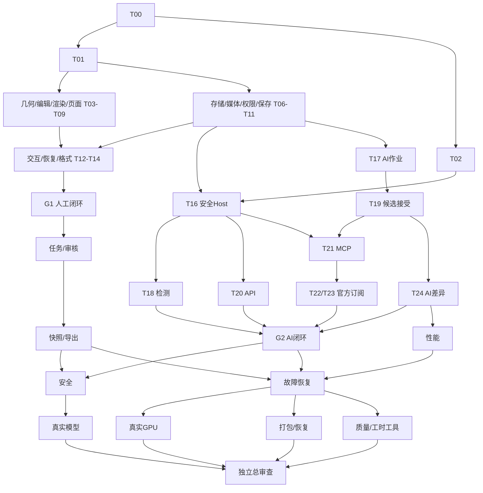

# WebLabel v0.1 实施计划

这份计划说明项目边界、任务关系和验收条件，不是当前完成情况。已有应用时从启动入口恢复；进度以 STATUS、实际提交和报告为准，不重新执行已完成任务。

## 要交付什么

在浏览器中完成真实 wgpu 图片标注与审校。官方订阅运行时和多模态 API 只生成候选；人工采纳必须可审阅、可撤销、可追溯，并进入统一编辑与保存事务。

原生 HTML/TypeScript 负责业务界面，Rust/WASM 负责编辑内核，wgpu 负责画布。单个 Rust 产品管理 SQLite、媒体/版本、HTTP provider、官方 Claude MCP 与 CPU 检测 worker。Node 仅构建/开发/验证，Python 仅独立导出/对照；Codex 已退役，仅保留历史身份解码。

技术栈为 Rust / Axum / SQLx / SQLite、wgpu / WGSL / WASM、HTML / TypeScript / Vite、构建期 Node/pnpm、Playwright / Vitest，以及可选 ONNX Runtime。固定版本与实测边界分别记录，不凭工具名称推断支持。原 T00–T35 是历史实施任务；活动 checks 已迁移为原生入口，当前重构按 R00–R11 依赖推进，不重跑已完成任务来改写历史。

开发仍使用用户指定的 omp。按协作规程完成隔离、测试、审查和集成；可使用已安装 skills，但不改用另一套编排工具。具体接口以架构、共享契约和测试约定为准；原始草案保留作历史对照。

## 本轮边界

- 面向桌面浏览器和静态 PNG / JPEG，编辑 bbox 与属性；首版正式部署只在 loopback。
- 坐标使用 canonical 连续像素，EXIF 变换可追溯；领域数值使用 f64，DPR 只影响显示。
- Rust 是编辑几何唯一来源。预测、文档、不可变版本、审核和快照分层，不让旧模型结果覆盖人工修改。
- 保存使用 CAS、幂等及同事务候选 journal；一次逻辑拖动只产生一个 undo。
- 订阅接入只使用用户本人官方运行时；禁止抓 token、转售凭证或未经授权外发。
- TASKS.json 是唯一任务 DAG。最多 3 个写入者加 1 个只读审查者；隔离未证实就串行。
- 没有运行真实模型或硬件，就不能标为 live / hardware 通过；mock 只能验证工程行为。
- 文件上限 64 MiB、单边 4096、像素 16,777,216、decoded 并发 1、GPU 纹理预算 256 MiB。超限必须明确拒绝，不能静默降质。
- 本轮不做 Mask、Polygon、视频、3D、云计费、实时协同或自研推理引擎。

## 审查时重点看什么

1. 图片含镜像方向或 DPR 改变时，显示与训练导出是否使用同一坐标。对应 T03 / T07 / T14 / T15。
2. 输入中断、IME、异步初始化时，是否避免半框、误删和旧图挂到新图。对应 T09 / T12。
3. 保存 ACK、AI 乱序、切图和跨版本时，是否保留新的 dirty 状态，并拒绝旧候选覆盖人。对应 T11 / T13 / T19 / T24 / T30。
4. 取消、崩溃、授权变更与恶意提示时，是否保护密钥、拒绝越权和自动重复计费。对应 T16 / T21 / T25 / T29 / T32。
5. 审核后继续编辑或导出中修改时，review 是否仍绑定原版本，snapshot 是否固定，negative 是否由人明确确认。对应 T26 / T27。

## 怎样按计划工作

先从 START_HERE 恢复，再读架构、契约和协作规程。只有尚未初始化时才串行执行 T00，不让多个工作者同时创建共享入口。

每张任务卡都应能单独派发：说明依赖输入、交付内容、文件范围、行为与断言、精确验收 argv、证据和停止条件。调度读 TASKS.json，运行状态读 STATUS.json。

| 关卡 | 要验证的成果 | 任务范围 |
|---|---|---|
| G0 | 固定版本的工作区和一致契约 | T00 / T01；T02 可并行核验运行时 |
| G1 | 真 wgpu 画框、保存、刷新、导出与加载 | T03–T15 |
| G2 | 模型候选、授权、差异、接受与撤销的完整链路 | T16–T25；mock 工程验证必须明确标注 |
| G3 | 审核、快照、权限、故障恢复和可重复构建 | T26–T30 / T33 |
| G4 | Windows 真实 GPU 与四个必需实际渠道 | T31 / T32；缺条件就 blocked |
| G5 | 测量工具、独立总审查和真实发布结论 | T34 / T35 |

不用按编号逐个串行。T26 可以与 AI 后半段独立推进，T33 / T34 可以在等待外部 G4 条件时完成。是否就绪、能否并行，都由依赖和 locks 决定，不靠表格顺序猜测。

## 完整任务目录

| Task | 可独立验收成果 | 主角色 | 前置 |
|---|---|---|---|
| [T00](tasks/T00.md) | 空目录启动、工具链与可执行测试入口 | main | 无 |
| [T01](tasks/T01.md) | 领域模型、共享契约、schema与黄金夹具 | wl-core | T00 |
| [T02](tasks/T02.md) | 官方运行时与模型接入探针 | wl-researcher | T00 |
| [T03](tasks/T03.md) | 坐标变换、矩形几何与空间命中 | wl-core | T01 |
| [T04](tasks/T04.md) | 编辑命令、工具状态与单步撤销 | wl-core | T03 |
| [T05](tasks/T05.md) | 真实wgpu图像与实例矩形渲染器 | wl-renderer | T03 |
| [T06](tasks/T06.md) | SQLite、不可变文件仓库与服务器骨架 | wl-backend | T01 |
| [T07](tasks/T07.md) | 图片导入、EXIF规范化与有界媒体作业 | wl-backend | T06 |
| [T08](tasks/T08.md) | React工作台外壳与虚拟对象列表 | wl-web | T01 |
| [T09](tasks/T09.md) | WASM facade与浏览器画布生命周期 | wl-renderer | T04, T05, T08 |
| [T10](tasks/T10.md) | 本地认证、项目角色和不可变标注规范 | wl-backend | T06 |
| [T11](tasks/T11.md) | 不可变保存版本、CAS与幂等事务 | wl-backend | T04, T10 |
| [T12](tasks/T12.md) | 矩形编辑、快捷键与密集选择全链路 | wl-core | T09 |
| [T13](tasks/T13.md) | IndexedDB恢复与单飞保存队列 | wl-web | T09, T11 |
| [T14](tasks/T14.md) | 原生、YOLO、COCO格式与安全导入预览 | wl-backend | T07, T10 |
| [T15](tasks/T15.md) | 人工标注最小纵向闭环与第一关卡 | wl-qa | T07, T09, T10, T11, T12, T13, T14 |
| [T16](tasks/T16.md) | 安全Agent Host、进程监管与provider抽象 | wl-ai | T01, T02, T10 |
| [T17](tasks/T17.md) | 持久化模型作业、预测与事件流 | wl-backend | T11, T07 |
| [T18](tasks/T18.md) | 真实CPU检测器与坐标反变换 | wl-ai | T07, T16 |
| [T19](tasks/T19.md) | 候选校验、原子接受与可撤销来源 | wl-core | T04, T17 |
| [T20](tasks/T20.md) | OpenAI/Luna、Anthropic与MiMo HTTP适配器 | wl-ai | T16 |
| [T21](tasks/T21.md) | 受限MCP语义工具与run级权限 | wl-ai | T16, T19 |
| [T22](tasks/T22.md) | Codex 活动渠道退役与历史身份保全 | wl-ai | T02, T21 |
| [T23](tasks/T23.md) | 官方Claude订阅/Sonnet运行时适配 | wl-ai | T02, T21 |
| [T24](tasks/T24.md) | AI面板、差异预览与按上下文接受 | wl-web | T13, T19 |
| [T25](tasks/T25.md) | 模型全链路、外发授权与差异化AI关卡 | wl-ai | T18, T20, T23, T24 |
| [T26](tasks/T26.md) | 任务租约、版本审核与负样本语义 | wl-backend | T15 |
| [T27](tasks/T27.md) | 不可变数据集快照与可校验交付 | wl-backend | T14, T26 |
| [T28](tasks/T28.md) | 密集对象性能、按需绘制与资源预算 | wl-renderer | T12, T13, T24 |
| [T29](tasks/T29.md) | 安全攻击面与恶意输入专项验收 | wl-qa | T25, T27 |
| [T30](tasks/T30.md) | 故障注入、恢复与长会话一致性 | wl-qa | T25, T26, T27, T28 |
| [T31](tasks/T31.md) | 目标机器真实WebGPU与性能验收 | wl-qa | T30 |
| [T32](tasks/T32.md) | 真实订阅、Luna/MiMo与检测器验收 | wl-qa | T25, T29 |
| [T33](tasks/T33.md) | 本地发行构建、诊断、备份恢复与使用文档 | wl-backend | T27, T29, T30 |
| [T34](tasks/T34.md) | 标注效率与质量评估工具 | wl-web | T15, T24, T27, T30 |
| [T35](tasks/T35.md) | 独立总审查、重放验收与发布状态 | main | T31, T32, T33, T34 |

## 主要依赖图

图用于理解模块；机器精确依赖以TASKS.json为准。

## 什么时候才算完成

完整首版需要 G0–G5 都有实际通过证据。Claude 本人官方订阅/full Sonnet、OpenAI API/full Luna、MiMo image API 和锁定 RT-DETR 四渠道不能互相替代；Anthropic API 可选，Codex 退役。缺账号、调用授权、真实证据或硬件仍 blocked；本轮安全排除不算通过，不把 T35 标 done。

代码任务完成与 provider 的 live_passed 是两种状态。计划结构检查、页面打开、构建成功都不替代真实验收。
