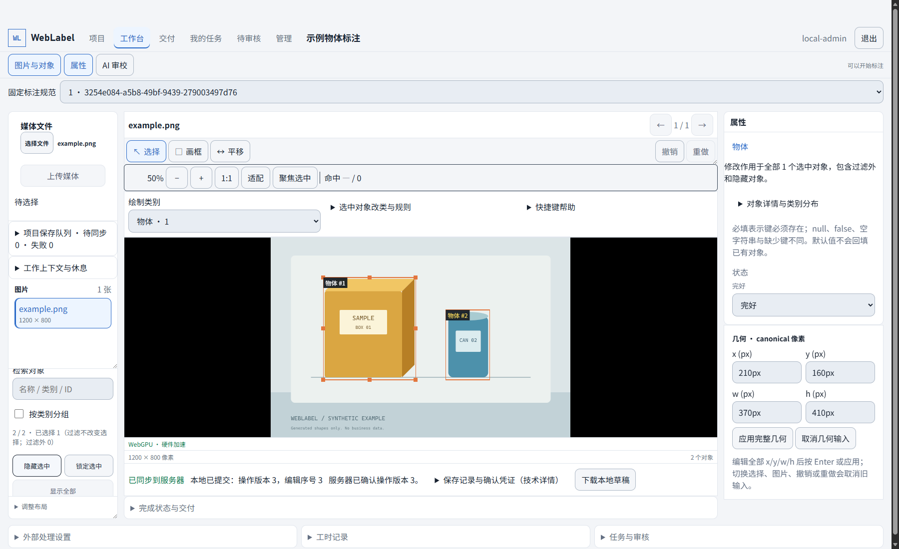

[中文](#chinese)

# WebLabel

WebLabel is a locally hosted image annotation tool. In your browser, you can draw bounding boxes, assign classes and attributes, review annotations, and export datasets. It supports PNG/JPEG images and YOLO, COCO, and native annotation formats.

To try manual annotation, use the pre-release package below; no AI setup is required. AI is an optional assistant that proposes candidates for you to accept or reject. The pre-release is for evaluation; full validation with real models and target hardware is still incomplete.

## Annotation interface

Select an image on the left, draw boxes in the center, and edit object classes and attributes on the right.



<details>
<summary>View class and attribute settings</summary>


</details>

The workbench screenshot uses v0.1.0-rc.3 and a synthetic sample image; the class settings screenshot is from an earlier version.

## Try it

### Download and launch

The pre-release package supports x64 Windows and Linux computers. Bounding-box editing also requires a desktop browser and graphics hardware with WebGPU support; desktop Chrome or Edge is recommended.

1. Go to the [v0.1.0-rc.3 downloads](https://github.com/lona-cn/weblabel/releases/tag/v0.1.0-rc.3). Choose the package ending in `win32-x64.tar.gz` for Windows or `linux-x64.tar.gz` for Linux, and download its corresponding `.sha256` checksum file.
2. Verify the SHA256 checksum using the [download and verification instructions](docs/getting-started.md#下载预发布包), extract the entire archive, and open a terminal in the extracted directory.
3. Run the launch command for your platform below. Keep the terminal open; press Ctrl+C to stop the service when finished.

Windows (PowerShell):

```powershell
.\launch.cmd
```

Linux:

```sh
sh ./launch.sh
```

The historical rc.3 package includes Node; manual annotation does not require a separate installation of pnpm, Rust, Python, or model tools. **The current source instead builds a v2 native distribution that runs a single Rust executable and has no Node/Python product runtime; a new download package has not yet been released.** Neither is a signed installer. Linux still requires compatible system libraries; see each package's `BUNDLE.md` for maintenance instructions.

After launch, open the `WEBLABEL_LOCAL_URL` displayed in the terminal, which defaults to `http://127.0.0.1:48100`. Without usable WebGPU, you can only view or diagnose the application, not draw boxes.

When launched as above, data is stored in `data` under the extracted directory. Continue using the same data directory on subsequent launches, [back it up](docs/backup-restore.md) before upgrading, and do not delete it along with an old application package.

### Annotate your first image

1. On first launch, enter the terminal's `WEBLABEL_BOOTSTRAP_CODE` in the web page, then set and confirm a password. The default administrator is `local-admin`. The bootstrap code is valid for ten minutes and can be used only once; do not share it or capture it in screenshots.
2. Create a project, configure classes and attributes, upload a PNG/JPEG image, and wait for processing to finish.
3. Open the image and select the newly created specification under “固定标注规范”. Select a class under “绘制类别”, click “画框” and drag a rectangle, then fill in attributes on the right. The change is saved to the server only once the status shows “已同步到服务器”.

If you already have an account, sign in with your username and password. If a service is already running, open its web address instead of starting another instance. See the [getting started guide](docs/getting-started.md) for review, importing existing annotations, and export.

<details>
<summary>Build from source</summary>

First prepare the pinned tool versions using the [development environment instructions](docs/getting-started.md#开发者从源码准备本地服务), then run the following commands one at a time from the repository root. If any step fails, resolve the error before starting the service:

```text
pnpm install --frozen-lockfile
pnpm build
.\target\local-release\weblabel.exe doctor --mode runtime --build-dir target/local-release
.\target\local-release\weblabel.exe serve --build-dir target/local-release --data-dir data --port 48100
```

The default build directory is `target/local-release`. On Linux, use `./target/local-release/weblabel`. Repeated builds do not overwrite the old directory; choose a new directory as described in [build and launch](docs/getting-started.md#构建与启动). When upgrading, explicitly pass the original data directory and keep the same browser origin; do not reinitialize the database or clear IndexedDB. `doctor --mode runtime` does not require build tools and does not prove that a GPU or model is available.

</details>

## Before you begin

- **Use locally only.** The default service is accessible only on the local machine; LAN and public deployment are not supported. The current scope is rectangular image boxes and attributes, not segmentation, video, or cloud deployment.
- **Check the save status.** “本地待同步” (pending local sync) does not mean the server has saved the change. If a conflict or save failure occurs, preserve the draft first, then follow the [troubleshooting guide](docs/troubleshooting.md).
- **An empty annotation is not a negative sample.** Explicitly confirm that an image contains no target objects; do not infer a negative sample from empty annotations alone.
- **Review requires a separate account.** By default, you cannot review your own submitted annotations; another account with review permission is required. Review applies only to the submitted version, and later changes must be resubmitted. A single account can still edit and save.
- **Check format differences before export.** Select the images and annotation versions to export and create a fixed snapshot. The application asks for confirmation if the target format would lose information such as attributes.
- **AI does not decide for you.** Candidates require explicit acceptance and can be undone. Before sending an image to an external model, project settings and server-side permissions must permit it, and you must authorize it. See the [known limitations](docs/known-limitations.md#模型事实矩阵) for models that have not yet been fully validated.

The repository is currently **UNLICENSED**; no permission for redistribution or commercial use has been granted.

## Further reading

- [Getting started](docs/getting-started.md): sign-in, import, annotation, review, and export.
- [Supported capabilities](docs/current-capabilities.md) · [Known limitations](docs/known-limitations.md) · [Troubleshooting](docs/troubleshooting.md).
- [Operations](docs/operations.md) · [Backup and restore](docs/backup-restore.md).
- [Development guide](docs/development.md) · [Continuing development](START_HERE.md).
- [Verification](docs/verification.md) · [Verification records](reports/index.md).

See the [documentation index](docs/README.md) for the complete list.

---

<a id="chinese"></a>

# WebLabel

WebLabel 是一个在本机运行的图片标注工具。你可以在浏览器里给对象画框、填写类别和属性，审核标注后导出数据集。支持 PNG/JPEG 图片，以及 YOLO、COCO 和原生标注格式。

如果你想先试试人工标注，可以直接用下面的预发布包，不需要配置 AI。AI 是可选的辅助功能：它给出候选结果，由你决定是否采纳。预发布版供试用，真实模型和目标硬件的完整验证仍未完成。

## 标注界面

左侧选择图片，中间画框，右侧修改对象的类别和属性。


<details>
<summary>查看类别和属性设置</summary>


</details>

工作台截图使用 v0.1.0-rc.3 和合成示例图；类别设置截图来自早期版本。

## 先试用

### 下载并启动

预发布包适用于 Windows 和 Linux 的 x64 电脑。画框编辑还需要支持 WebGPU 的桌面浏览器和显卡，建议先用桌面 Chrome 或 Edge。

1. 到 [v0.1.0-rc.3 下载页](https://github.com/lona-cn/weblabel/releases/tag/v0.1.0-rc.3)，Windows 选择以 `win32-x64.tar.gz` 结尾的包，Linux 选择以 `linux-x64.tar.gz` 结尾的包，同时下载对应的 `.sha256` 校验文件。
2. 按[下载与校验说明](docs/getting-started.md#下载预发布包)核对 SHA256，完整解压，再在解压目录打开终端。
3. 执行下面对应的启动命令。终端需要一直开着；用完按 Ctrl+C 停止服务。

Windows（PowerShell）：

```powershell
.\launch.cmd
```

Linux：

```sh
sh ./launch.sh
```

上面的 rc.3 历史包仍带 Node，人工标注不需要另装 pnpm、Rust、Python 或模型工具。**当前源码改为 v2 原生发行，只运行一个 Rust 可执行文件，不含 Node/Python 产品运行时；本次尚未发布新的下载包。** 两者都不是签名安装器；Linux 仍需要兼容系统库，维护说明以各包的 `BUNDLE.md` 为准。

启动后打开终端显示的 `WEBLABEL_LOCAL_URL`，默认是 `http://127.0.0.1:48100`。如果没有可用的 WebGPU，只能查看或诊断，不能画框。

按上面的方式启动时，数据保存在解压目录下的 `data` 中。后续启动请继续使用同一数据目录，升级前先[备份](docs/backup-restore.md)，不要把数据随旧程序包一起删掉。

### 标注第一张图

1. 首次启动时，把终端中的 `WEBLABEL_BOOTSTRAP_CODE` 填入网页，设置并确认密码。默认管理员是 `local-admin`；启动码十分钟内有效，只能用一次，不要分享或截图。
2. 新建项目，设置类别和属性，上传一张 PNG/JPEG 图片，等待处理完成。
3. 打开图片，在“固定标注规范”中选择刚创建的规范。再从“绘制类别”选择类别，点击“画框”并拖出矩形，在右侧填写属性。确认状态显示“已同步到服务器”后，这次修改才算保存到服务端。

已有账号时直接用用户名和密码登录。已有服务时直接打开它的网页地址，不必再启动一份。后续的审核、导入已有标注和导出步骤见[入门指南](docs/getting-started.md)。

<details>
<summary>从源码构建</summary>

先按[开发环境说明](docs/getting-started.md#开发者从源码准备本地服务)准备固定版本的工具，再在仓库根目录逐条执行；任一步失败都先处理错误，不要继续启动：

```text
pnpm install --frozen-lockfile
pnpm build
.\target\local-release\weblabel.exe doctor --mode runtime --build-dir target/local-release
.\target\local-release\weblabel.exe serve --build-dir target/local-release --data-dir data --port 48100
```

默认构建目录是 `target/local-release`。Linux 使用 `./target/local-release/weblabel`。重复构建不会覆盖旧目录；按[构建与启动](docs/getting-started.md#构建与启动)选择新目录。升级须显式传入原数据目录并保持原浏览器 origin，不重初始化数据库或清空 IndexedDB。`doctor --mode runtime` 不要求构建工具，也不证明 GPU 或模型已可用。

</details>

## 使用前注意

- **只在本机使用。** 默认服务只供本机访问，不支持局域网或公网部署。当前只做图片的矩形框和属性标注，不支持分割、视频或云端部署。
- **留意保存状态。** “本地待同步”不等于服务端已保存。遇到冲突或保存失败，先保全草稿，再按[故障指南](docs/troubleshooting.md)处理。
- **空标注不等于负样本。** 一张没有框的图片，需要明确确认没有目标，不能仅凭空标注把它当作负样本。
- **审核需要独立账号。** 项目默认不能审核自己提交的标注，需要另一个有审核权限的账号。审核只对当时提交的版本有效，后续修改需要重新提交；单账号仍可编辑和保存。
- **导出前检查格式差异。** 先确定要导出的图片和标注版本，生成固定快照；如果目标格式会丢失属性等信息，应用会要求你确认。
- **AI 不替你做决定。** 候选结果需要明确采纳，也可以撤销。图片发给外部模型前，必须满足项目设置和服务端权限要求，并获得你的授权。哪些模型还没有完成验证，见[已知限制](docs/known-limitations.md#模型事实矩阵)。

仓库目前为 **UNLICENSED**，没有授予再分发或商业使用许可。

## 继续阅读

- [入门指南](docs/getting-started.md)：登录、导入、标注、审核和导出。
- [支持范围](docs/current-capabilities.md) · [已知限制](docs/known-limitations.md) · [故障指南](docs/troubleshooting.md)。
- [运维手册](docs/operations.md) · [备份与恢复](docs/backup-restore.md)。
- [开发指南](docs/development.md) · [继续开发](START_HERE.md)。
- [验证说明](docs/verification.md) · [验证记录](reports/index.md)。

完整目录见[项目文档](docs/README.md)。
