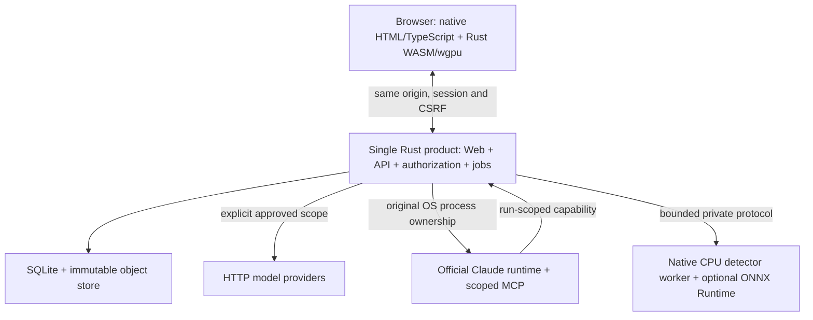

# 架构与范围冻结：WebLabel v0.1

供维护者判断模块职责、数据边界和首版范围。本文冻结设计，不证明实现或性能已经通过验收。设计日期：2026-09-25。

## 1. 目标与演示路径

实现一个浏览器里的高性能图片标注与 AI 审校工作台。用户导入图片和已有检测标签，在 wgpu 画布修正矩形及对象属性，运行检测或多模态辅助，把候选变更逐项/批量接受，保存、审核、冻结数据集并导出。

首个差异化场景固定为“密集对象的检测结果修正 + 按自然语言批量检查对象属性”。演示规范包含 person 类和 helmet_state=wearing/not_wearing/unknown 属性；它只是样例项目，不得硬编码进业务逻辑。用户可以新建其他类别和属性规范。

验收演示：导入 20 张图及 COCO 标签 → 选择一张包含多个对象的图 → 指令“只检查安全帽属性，不改框；看不清的设为 unknown” → 展示逐对象差异 → 选择接受 → 一次撤销恢复整批变更 → 重新接受并保存 → 提交并审核指定版本 → 导出 YOLO/COCO 和属性损失报告。

没有账号或没有真实模型时，继续开发并展示明确标识的模拟结果，但不得把该演示标成真实模型通过。

## 2. 相对原草案的明确变更

最初的用户草案作为[原始归档](reference/original-proposal.md)保留，不是当前实现说明。坐标、预测隔离、保存、审核和快照的不变量继续有效；本版作出以下取舍：

| 项目 | 本次冻结决定 |
|---|---|
| VLM 优先级 | 从后续增强提前到首版差异化闭环，不能只交付普通画框器 |
| 首期部署 | 本地服务 + 浏览器；不是纯静态网页，也不是先建设多租户 SaaS |
| 默认环境 | Windows 11 的桌面 Chrome/Edge 为首要人工验收平台；Linux 用于无凭证自动化；其他平台分别报告验证状态 |
| 存储 | Rust 服务 + SQLite WAL + 内容寻址文件存储；不要求 Docker/PostgreSQL/Redis/S3 才能启动 |
| AI 集成 | Claude 官方本地运行时；OpenAI、Anthropic、MiMo API 适配器；一个实际检测适配器。Codex 活动通道退役，历史身份仍可解码 |
| 协作 | 基础项目角色、任务占用、版本冲突和审核；不做实时共同编辑 |
| 大图与分割 | v0.1 不做金字塔、Polygon、Mask；以准入限制保护内存，后续另立任务 |
| 本地推理 | 原生 CPU Worker + 可选 ONNX Runtime；Python 只作导出/独立对照，浏览器推理和自研 ONNX 引擎不进入产品 |

首版先交付可验证的本地软件，云端部署须另行设计。普通图片编辑不依赖 Python、模型权重、官方 CLI 或订阅登录。

## 3. 技术栈与固定版本策略

- UI：原生 HTML + TypeScript + Vite；DOM 承担表单、虚拟列表、属性和 AI 面板。controller 持有状态，Rust 仍是唯一可编辑几何来源；无 React root、hooks 或兼容展示 adapter。
- 内核：Rust 2021 edition；geometry、annotation-domain、editor-core 都能在无 GPU 的 native 单元测试中运行。
- 渲染：wgpu 30.0.1、WGSL；wasm-bindgen/wasm-pack 构建浏览器模块。版本组合与历史验证见 compatibility.md，不用旧教程推断当前 API。
- 服务：Rust、Tokio、Axum、SQLx SQLite、tracing；单个模块化服务，内部持久化作业队列。
- 原生 runtime：同一 Rust 产品负责 provider HTTP、官方 CLI 可信子进程、受限 MCP 与运行级权限，不建立第二份业务数据库。
- 检测：Rust CPU Worker + 锁定的 ONNX Runtime/model/label mapping；Python 导出工具与产品分离，不默认打包或下载模型。
- 测试：cargo test/proptest、Vitest、Playwright 与独立导出工具 unittest；工程 fixture 与真实 provider/GPU 验收分开。
- JS 包管理：pnpm，packageManager 与 pnpm-lock.yaml 固定精确版本。工具安装情况须单独检查，不假设 Corepack 预装。

T00 的版本选择算法：读取已安装版本 → 查官方稳定版/MSRV/兼容要求 → 先编译最小 Rust→WASM→wgpu 画布及 Node 子进程探针 → 把成功组合记录在 docs/compatibility.md、rust-toolchain.toml、package.json 和 lockfiles。Node 固定 24.x 的实际补丁号；Rust 固定实际通过的稳定补丁号且不低于 wgpu/MSRV；禁止写 latest、*、浮动 Git HEAD 或仅写 stable 作为交付工具链。

只有主 Agent 修改 workspace manifests/lockfiles。子 Agent 把新增依赖、用途、版本和许可证写入 reports/Txx/dependencies.json，由主 Agent串行批准并更新。不得为避开编译问题重写渲染后端或替换整个技术栈。

## 4. 运行拓扑

正式入口 `weblabel serve` 默认单一 `http://127.0.0.1:48100`，只有 `--port`，由 `WEBLABEL_LOCAL_URL` 输出精确 origin。开发仍为 Vite 5173 → API 48100 的 proxy；更改 bind 不自动更改 Vite。正式升级显式复用原 canonical 数据目录和 origin，不初始化新库或清 IDB，先验证备份。拓扑和参数见[开发指南](development.md)与[配置参考](configuration.md)。

正式本地启动只绑定 loopback。Host 与 Origin 精确白名单，不允许 `*`。服务必须有本地启动认证，不可认为“localhost 就不需要认证”。初始管理员通过一次性启动码换取 session；启动码从本地终端交给用户，不放 URL query、日志或前端包。会话用 HttpOnly、SameSite=Strict cookie；HTTPS 时设置 Secure，loopback HTTP 单独明确配置。

写操作要求 CSRF token/Origin 验证，登出撤销会话。生产拒绝测试认证开关。

API启动必须显式提供 `WEBLABEL_COOKIE_SECURE=true|false`；`scripts/dev.mjs` 对 loopback HTTP 设置 `false`，通过 HTTPS 访问时设置 `true`。首次空数据库启动时，API仅向本地终端输出 `WEBLABEL_BOOTSTRAP_CODE`，有效期10分钟且只能换取一次初始管理员 session；bootstrap 同时要求用户设置不少于12字节的初始密码，密码只存 Argon2id 哈希，使管理员可在 session 撤销/过期后重新登录。

已有用户时不输出启动码。Host/Origin 白名单按绑定 loopback 地址、API端口和 Vite 开发端口精确生成。

管理员密码恢复采用独立exclusive maintenance，不复用bootstrap或正常session。可信启动输入固定request UUID与已有platform_admin；终端随机code600秒一次，Web投递code及不trim的新密码，strict Origin授权不依赖旧cookie。原user_id/成员/历史不变，Argon2id更新、目标session撤销、immutable completion同事务；消费ID跨重启拒绝。完成仍维护，清环境并正常重启才登录。所有API持规范化数据库旁OS锁；维护不启动workers/Host或恢复业务运行。GET与POST公平等同一门，授权操作断连仍持门直到结算，未知结果只读核对。详见[运维](operations.md#管理员密码恢复)与[HTTP参考](api-reference.md#管理员密码恢复维护)。

v0.1 的订阅模式仅供本机最终用户本人运行。把服务改为非 loopback 监听不是受支持的上线方式。团队/远程 SaaS 的本地伴随程序配对、租户计费和公网运维另立方案，不可让远端用户消耗服务器所有者的订阅凭证。

### 4.1 原生 Rust 迁移入口（R02）

`weblabel` 是唯一产品 binary，CLI、同源 server、doctor、备份恢复、MCP 与 detector 都在现有 weblabel-api library。旧默认 binary、Node/Python 产品和旧配置加载器已切除。serve 只流式提供已验证 v2 manifest 中的静态资源；API 404 不回退 HTML，CSP 不要求字符串求值或 inline-style 放宽。

维护模式只开放账户恢复依赖和恢复 API，不启动业务 worker/运行恢复。正常停机停止接单、撤销 run capabilities、结算 interrupted/unknown、等待 worker 与两个 SQLite pool 关闭，再释放 OS sidecar 锁；shutdown receipt 不宣称已取消上游计费。首次 bootstrap 在资格读取前、规范发布在版本号读取前取得 SQLite writer reservation；两者共用 storage 的专用 close-on-drop 连接，构造阶段取消不能池化仍活动的写事务。只读事务不因此升级为写事务。

唯一原生配置按 `(provider_id, profile_id)` 精确选择并保留数值类别的配置 hash。AgentToolService 由 HTTP/MCP 共同执行运行级授权，region 内部传原始字节，仅边界编码。factory 已组装 R03–R05；实现、synthetic 协议通过与真实模型可用性分开，未验收的官方账号/模型仍 blocked。

## 5. 状态的唯一来源

| 状态 | 所有者 |
|---|---|
| 当前可编辑几何、工具状态机、撤销栈 | Rust EditorCore |
| 已持久化不可变版本、审核、任务、预测 | Rust API + SQLite |
| UI 面板展开、搜索、请求加载状态 | 原生 DOM 展示与 controller；认证、AI、任务、保存均只有一个状态所有者 |
| 图像纹理、实例缓冲、选中覆盖层 | Renderer，仅缓存 |
| 本地待同步草稿 | IndexedDB，包含业务文档而非 GPU 数据 |
| Provider 密钥、认证状态 | 最终用户的官方运行时或本地 secret store；不属于项目数据 |

Rust EditorCore 拥有可编辑几何。TypeScript 只读取投影，不维护第二套可修改 bbox。创建、修改、采纳与撤销都走 EditorCommand；服务器仍重验每次保存，WASM 客户端不是信任边界。

实体引用、原图/canonical、分支作者与真实提交证据见[数据生命周期](data-model.md)；精确 wire 与当前恢复增量见[共享契约](contracts.md)。

### 5.1 原生 Web 迁移的共享接缝（R01）

公开入口由原生 main/routes 统一装配并管理 controller 的订阅、取消和销毁。没有旧 root、useRun、providers 或第二套公开路由。测试 observer/dense harness 仅 test mode 懒加载，正式页面不暴露任意命令 facade。

- `app/session.ts::createSessionController` 持有认证 union、generation fencing、bootstrap ACK/unknown 与单飞边界。构造不请求；owner 调用 `refresh()`。每次新 login 独立推进 generation，旧响应不能安装身份。
- `features/ai/run-controller.ts::createRunController` 保留原 scope、固定文档/规范、严格 after cursor、候选缓存和接受/保存 journal。`getSnapshot()` 未变化时保持同一对象，读取不复制候选文档。
- `selection-store.ts`、`tool-state.ts` 和 `review/task-session-port.ts` 是投影/任务的共享接缝；可编辑几何、undo、SaveQueue、outbox 与 IndexedDB 身份不变。`route-state.ts::readRoute(URL)` 由当前路由复用。
- 页面遵循 `mountX(root, context): () => void`；共享 `PageContext` 显式传入 session、navigate、signal 和 route，不借 window 单例。销毁取消监听、观察器、定时器和只读请求，不把 abort 当作撤回已发送写入。
- `ui/` 基元使用原生 button/input/select/dialog 和纯文本 DOM 更新。长列表由 `@tanstack/virtual-core = 3.13.12` 负责范围与测量；首次通知在观察器完成登记后发布，通知内 abort 必须完整解绑，不再通知已销毁 consumer。

行为边界与验证见 R01 交接（私有归档：`reports/T08/html-rust-rebuild/r01-controllers.md`）及真实合成 consumer 运行记录（私有归档：`reports/T35/html-rust-rebuild/r01-main-native-input-smoke.json`）。这些不是原生产品页面、GPU 或真实模型通过证据。

### 5.2 原生页面组合契约（R07/R08）

`features/workbench/workbench-context.ts` 是纯类型组合边界，不是展示模块。工作台通过必需的 `mountReview`、`mountManagement`、`mountTransfers` 注入真实页面；review 接收共享 `TaskSessionPort` 和可观察 scope/queue，transfers 只经显式 prepare/commit/release/export callbacks 触及编辑器生命周期，不访问几何或 SaveQueue 内部。

导入上下文固定 asset/ontology、可空 base_revision_id 与生成的 SaveLease；原生工作台和 transfer 直接消费纯类型，不从展示模块 re-export。无历史 head 可用 null base，不为类型检查预造 revision、要求额外保存或确认 negative。scopeKey 是独立对象身份凭据，不进入 wire，不通过同值新对象恢复权限。

只读 API 显式接受 owner AbortSignal，身份/权限/authorization epoch 撤销会终止自有读取，不取消或重试已发送 POST。媒体上传另用 `canUploadMedia`：真实项目角色、catalog 与生命周期围栏决定，不要求已有 asset、可编辑 head 或 GPU；标注导入仍用独立 `canWrite` 及原 scopeKey，不能用上传权限绕过保存围栏。

### 5.3 账户与项目原生页面（R06）

账户、项目、成员、外发策略与模型预设页面均可独立 mount/dispose，公开路由消费同一 controller。语义差异区分 false/0/null/空串/未包含，比较不修复非法草稿或发写请求。未知创建/发布不认领同名结果，平台权限与项目成员分开。R06 独立挂载证据不能替代最终路由、200% zoom 或 CSP 发行验收。

### 5.4 原生工作台与交付的组合证据（R07/R08）

`workbench-page.ts` 的 controller、editor-port、task-session、draft-recovery 和 DOM view 复用原 C3、SaveQueue、导入 outbox 与唯一 run controller；仍只在 Rust 命令结果后发布几何投影。临时组合页已实际验证分数像素绘框、pointermove 仅预览、单次 Undo/Redo、保存与未知 ACK 恢复，以及 NVIDIA Blackwell 上真实 device.lost 后恢复同一 CPU facade、文档和历史。它不是正式第二路由。

同项目重挂页面会撤销旧 writer 的本地凭证。loader 在读取当前服务器 head 后，只为 asset/ontology/base/document/generation 全部精确匹配、没有 dirty/pending/冲突/ACK barrier 的干净保留分支重新执行本地持久化；保留 generation 和分支身份，等待后读取新凭证。凭证必须来自真实 guarded IndexedDB 事务完成，不合成成功、不新增编辑或保存 POST，也不把这描述为新增跨标签页 CAS。Task 准备仍独立检查当前凭证、Native generation、分支、身份和 lease。

实际任务领取/续租/转交/提交与继续、固定 revision 审核、新 head 不继承批准、三格式导入导出、不可变 DatasetVersion、未知写入跨挂载和 53 条任务虚拟列表见组合验收（私有归档：`reports/T12/html-rust-rebuild/r07-r08-composition/report.md`）。原失败与修复后 11/11 分开保存。该次未调用 provider，也未验证最终 router/popstate、严格 CSP、发行、200% zoom、真正 unsupported-WebGPU 或性能/1024 规模；后续 R09/R10 证据独立记录。

原生 AI 候选到达后清除旧空状态提示，但保留真实批次决定摘要。运行摘要刷新键同时绑定当前 run 对应图片的已确认 `base_revision_id`：撤销的本地提示或 run event 不变，也必须在后续保存 ACK 后重新读取真实决策数；不轮询模型、不重发决定或把 unknown 填零。主会话实际页面验证（私有归档：`reports/T35/html-rust-rebuild/r07-outcome-main/acceptance.json`）通过公开预设配置、真实服务与 Rust/WASM，显式采纳后一次 Undo 恢复原文档，服务端 accept/revert 与页面自动更新一致。上游仅两次本机 synthetic HTTP 请求，不是真实模型或检测器数值验收。

## 6. 目录职责

| 实际 package/crate 或模块 | 职责与边界 |
|---|---|
| @weblabel/web（apps/web） | 原生 HTML/TypeScript 页面、项目/工作台/AI/审核/数据集；只读 Rust 投影、IDB 与 HTTP 保存队列，不重写几何 |
| weblabel-api（crates/weblabel-api） | 单个 weblabel Rust 产品：静态 Web/WASM、Axum API、认证、媒体、保存、AI、审核、数据集、原生运维；可信父进程监管本次授权子进程 |
| annotation-domain | Rust 领域类型、验证、JSON schema/TS 生成来源及内容 hash |
| geometry | bbox、命中与坐标变换；无 GPU native 能力 |
| editor-core | 可编辑文档、命令/工具状态机、undo/redo 与候选接受 |
| renderer-wgpu | GPU 资源、实例投影和 WGSL；只保存缓存，不拥有业务文档 |
| wasm-bridge | Rust 编辑/渲染浏览器 facade 与 Native 装配 |
| dataset-formats | native/COCO/YOLO 解析、转换与信息损失报告 |
| xtask / @weblabel/contracts | 从 Rust 生成及检查 wire TS/JSON Schema；生成物禁止手改 |
| runtime detector | 原生 CPU Worker、锁定模型和显式类别映射；ONNX Runtime 可选，模型不默认打包；Python 仅保留独立导出/对照工具 |
| scripts / tests / reports | 跨平台入口、隔离测试与绑定运行条件的证据；历史报告不可倒写 |

workspace 只保留实际需要的 package、crate 和脚本。一个 crate 可以很小；新增模块应有真实调用者，不预建未使用的抽象类。

## 7. 坐标、输入、渲染约定

持久化使用基准图连续像素坐标，原点左上，x 向右、y 向下，边界 [0,W]×[0,H]，bbox=[xmin,ymin,xmax,ymax]，宽高不加 1。领域 f64；GPU 上传 f32。全部数值有限，框面积正；首期规范不允许超出图像。

原图不可变；服务端统一 EXIF 1..8（包括镜像），生成方向明确的 canonical PNG；预览不改变几何基准；首期导出 canonical 图及对应坐标，不承诺导回原始方向。原始文件与变换保存在原生包中。

视图公式：canvas_css=(image*scale)+translation；指针先减 Canvas bounding rect；DPR 只用于后备像素尺寸，不能再次乘进图像坐标。缩放锚点保持鼠标处 image 坐标不变。控制点 8 CSS px、命中半径 6 CSS px，变焦不改变屏幕触控大小。

工具：选择、框选、拖动创建矩形、四边/四角 resize、移动、多选、重复、删除、改类别/属性、平移、缩放。Esc 取消预览；pointercancel、失焦和切图都不生成半成品；pointer capture 与释放必须配对。中文输入法 composition 和文本框聚焦时禁用编辑快捷键。一次拖动/批量接受=一个撤销单元。

最小交互框边长 2 CSS px，提交还需图像空间正面积。

正式 Workbench 复用单个 Keyboard 路由，目标限真实 workbench-grid；项目导航、审核和 AI 控件、文本输入及 IME 不触发编辑快捷键，原生控件保留 Space 激活。SelectionStore 只消费当前 session 已接受的 Native delta，列表/属性/AI 选择都是该投影；applyDelta 仍是唯一完整快照/IDB/保存 producer。

命令、工具切换和取消在事件时重新检查 host/session/asset、真实 ready、只读 preview 与同步 submission ref fence，不能仅依赖 DOM inert 或渲染时状态。ToolState 的有效/base 工具只在 Native boolean ACK 后改变；设备或审核阻塞期间被拒绝的 Space 松开/blur 只记录有界用户意图，在 ready/解锁后协调该意图，不在一般恢复时重置工具或取消保留的预览。

Renderer 用批量实例矩形、缓存 image texture、增量更新、按需重绘。预览与正式对象分层。画布标签只显示选中/悬停及视口前 100 个对象，其余通过 DOM 虚拟列表查看，不能生成万级 DOM 标签。CPU 空间索引 + 明确排序实现重叠循环选择，不做同步 GPU 回读命中。
真实 WebGPU 画布进入 `inert` 时仍显示原图与对象轮廓，不绘制手柄或手势预览；状态切换触发一次仅呈现重绘，退出后从原 Native 选择恢复。GPU 设备重建后依据当前画布状态重绘，不以隐藏标志或更改选择代替只读呈现。
WASM Renderer 的 `update_viewport` 专供 pan/zoom/resize，仅更新 uniform；`update_objects` 只接收 objects/overlays projection，并将连续差异写入 instance buffer；`update_scene` 用于完整 scene/image 替换，不应被普通 pointermove 调用。

Rust Core 的 dispatch/Undo/Redo 共用对象差异 producer：只有对象数量与每个位置的 ID 顺序均相等时，才逐对象做完整领域值比较并按 canonical 顺序输出 replacements；成员/顺序变化保留通用按 ID 的比较与移除路径。全部文档 validation、前后 snapshot history 和预算不因快速路径减少。

临时 selection 与 flags 都为空才免建 membership 集合，否则以借用的当前 ID 过滤两者；临时状态不进入文档。Native projection 缓存实际选中 ID 列表，只有列表相同且 entry topology 未变化才免重复同步；插入/移除 entry 必须失效，bounds/color 更新与整 entry 排序保留 flags。

该缓存不把 canonical 文档位置当作紧凑 GPU instance slot。

无 WebGPU 显示诊断和导出/查看列表入口，不静默换 Canvas2D 并宣称完成 wgpu；WebGL 降级不在 v0.1。设备丢失时保留 CPU 文档、本地保存与错误状态，重建资源成功才恢复编辑；零尺寸 Canvas 暂停 configure/render。

## 8. 媒体与资源预算

v0.1 接收静态 PNG 和 JPEG，单文件 ≤64 MiB、宽高分别 ≤4096、总像素 ≤16,777,216。SVG、动图、TIFF、PDF/视频、CMYK/无法明确处理的色彩格式拒绝并给原因。通过解码头验证，不信扩展名或浏览器声明 MIME。保留原图元信息，不能把显示色彩处理宣称为色彩校准。

一次解码任务并发 1，媒体后台任务并发 2，当前图+相邻图最多 3 张解码缓存；GPU 纹理预算 256 MiB，超预算先淘汰邻图并显示占用。用实际 adapter limits 进一步缩小可显示范围，超限明确拒绝，不按低清图坐标保存。

单图软压测 10,000 个框；可写入硬上限 50,000 个框、文档 JSON ≤32 MiB。API 独立设置上传/保存/候选响应的不同 body limit。候选每次最多 1,000 个变更，AI 单次 crop ≤16 张，每张边长 ≤1536（检测器预处理另有记录）。这些是初始安全预算，可在有实测的 ADR 中修改。

## 9. 保存与版本

AnnotationRevision 不可变，head 单独引用。保存携带 operation_id、base_revision_id、document；服务器在单事务中先核查幂等，再比较 head，写新 revision 并原子替换 head。相同 operation_id + 相同请求哈希返回原结果；不同负载复用 operation_id 返回 409 IDEMPOTENCY_KEY_REUSE；版本不匹配返回 409 REVISION_CONFLICT。

`GET /api/assets/{asset_revision_id}/annotation` 必须显式指定 `ontology_version_id`；历史 revision 通过 `GET /api/annotation-revisions/{id}` 只读访问。当前普通 PUT 在 SQLite 写事务内以 actor/operation/kind 查询幂等记录；新操作核验项目写权限、固定任务 asset/ontology 的 lease/holder/expiry/fencing、canonical 尺寸、规范、几何/负样本与来源。suggestion_decisions 的接受/撤销与 revision、CAS head 和幂等 ACK 同事务提交，冲突不留半写。

已成功普通 save 的原请求回执重放仍需当前 actor 的项目写权限，但不要求原 lease 仍未过期；这不是 fresh 写入资格。annotation import 也先核对原 preview actor 与当前项目写权限；相同原请求已成功时返回存储 ACK，不重新验证当前 lease/fence/base，新提交才检查这些资格。历史 unknown 必须保留原 operation/body/base/lease/journal，不能借新 lease 包装原请求；明确新鲜 lease 拒绝才可按当前 Native/context 显式 reprepare。完整成功/未知/冲突时序见[数据模型](data-model.md#保存候选-journalcas幂等与-lease-的一次事务)，当前恢复约束以[共享契约增量](contracts.md)为准。

客户端每个标签页的 writer 队列对同一 asset 只允许一个保存请求在途；跨标签页各自保留分支，服务端 CAS/lease/fencing 仍是提交边界。只有当前 branch/write_token 的完整本地事务证据才能显示“已保存本地”。旧 generation 或旧分支 ACK 不能把更新中的文档显示为已同步。逻辑操作结束后防抖 400ms；提交审核、AI 启动、切图前执行 flush；失败时保留草稿和可下载恢复包。切图不得丢弃原图片的保存队列。

IndexedDB v2 的 draft_branches 使用 [asset_revision_id,draft_id] 复合键，envelope 保存 write_token、原始 DraftRecord 与 sources；完整 Native document、base/generation、pending 原 payload/operation、owner/outcome、有序 decision journal 都保留。v1 升级在同一事务复制原值；失败整笔回滚，blocked 明确失败，原 v1 可只读救援。多个分支必须显式选择，不用“最近更新时间”替用户选胜者，不合并几何，不自动 replay 旧 CAS。未知格式只允许原文救援；JSON 编码失败必须报告且不能删数据或生成假恢复包。

恢复/fork 使用新的 writer/draft/token；recover/use_server 引用精确来源 token，以固定点分类 active/archive/rescue_only。recover 只有目标真实同步后才完成来源处理；显式 use_server 在目标分支本地完整提交后将来源留档，archive 不等于上传/采纳原草稿。过期、缺失或循环来源引用不能悄悄消除未解决状态。新任务必须在创建/claim 前后异步重读该 asset 全部分支与当前组件上下文；只有已认证 paused fork 对完全相同 owner/asset/fixed task/ontology/base 的窄重新 claim 可恢复原任务，不能借此创建新任务。IDB 与 HTTP 不假称原子；校验失败必须释放取得的 lease，且不能安装新 Native。

浏览器配额失败必须可见。撤销已同步变更会保存新 revision，不删除历史。

## 10. AI：结构、语义与权限

Provider 是通道，不是模型；Profile 固定 provider、完整 model_id、认证类型、能力与验证状态。活动通道为 claude_local、openai_api、anthropic_api、mimo_api、detector_local；Anthropic API 可选，其他四项是 T32 必需。codex_local 仅保留历史解码，不提供活动执行兼容路径。一个通道通过不代表其他通道通过。

Claude 使用官方未修改运行时及其认证流程。不得复制 OAuth token、伪造客户端、调用未公开的订阅后端、将用户令牌发到自己的中转。具体合法使用边界和套餐能力由 T02/T32 结合官方资料与实际账号核实；不把“能登录”当成“允许任意商用代理”。

OpenAI API 可将 gpt-6-luna 作为当前候选型号，但选择器以实际授权和输入能力为准，不写死所有账号都能使用。Sonnet 也必须显示完整 model_id。MiMo 具体多模态型号、端点和输出限制在 T02 从官方平台核验；配置缺失时 unavailable，不冒充 OpenAI 全兼容。

API Key 的边界是启动环境或本地 secret store，不落 IndexedDB/localStorage、项目导出、报告、日志和 Git；公开界面不得回传原值。平台管理员可在“账号、成员与模型配置”中选择操作者已准备的固定 Host 预设，经服务端校验配置哈希和真实 provider/model/auth/capabilities 后明确保存；不接收密钥、任意路径或启动命令，不登录、不下载、不调用模型。没有预设仍可人工标注；静态配置不授予 live_passed。私有 JSON/credential 环境、持久配置、公开投影、项目策略和逐次 consent 是不同层，见[配置参考](configuration.md)。

运行前：flush 当前文档 → 固定 revision、ontology、媒体 hash 和作用对象 → 显示外发预览与目标提供方 → 用户授权 → 入队。确认绑定 input_fingerprint，不得确认后增加其他图片。每次运行记录成本/用量可用字段；未知费用显示未知，不显示为 0。

VLM 默认只建议类别/属性/疑似问题；精确框候选优先使用检测器。VLM 不充当检测器前置存在性过滤。结构合法不代表识别正确。模型自报 confidence 不用于免审或解释为正确概率。

Prediction 原始结果不可修改。SuggestionSet 存具体 patch 与原因；接受操作经 EditorCore 校验、预览、显式确认和可撤销命令才更新 Draft。Agent 没有 accept/delete-export/project-admin 等工具。

异步结果永久归属原 asset/revision。修改了作用对象、规范、媒体、draft_generation，或有新运行替代旧请求时标 stale。v0.1 不自动 rebase：用户查看差异后重新运行；对仍完全匹配的子集，必须显式选择并重新校验 before_hash 才能另建接受事务。取消后允许记录已返回原结果，但不再生成可自动接受状态。

## 11. 官方运行时的安全边界

同一 Rust 父进程持有本次原始 OS 进程树能力，按固定 argv、可信原生 executable、受限 cwd 与最小环境启动官方 CLI/检测器。浏览器不能指定 executable、cwd、环境、文件路径或任意 URL；禁止 shell 拼接、执行模型代码或 shell:true。原始根退出时先回收仍持有 pipe 的自有后代，再解释已缓冲 terminal/usage，不等到整个运行 deadline。

媒体用不透明 grant_id → 私有暂存文件映射；路径必须在本次运行根目录内，拒绝 traversal、symlink escape、Windows drive/UNC 绕过。MCP 暴露有限的 get_context/list_objects/read_region/propose_changes/report_issues；每次重新检查 project/run/asset 和授权预算。

通过官方支持的配置限制 CLI 文件/命令/网络工具，拒绝权限升级请求，不使用危险跳过审批参数。隔离 cwd 不等于安全沙箱。T02/T29 必须证明模型无法读取 home、凭证或其他项目，不能用 system prompt 代替权限隔离。某版运行时无法满足边界时，将该通道标 unavailable/blocked，保留 API 通道并报告缺失；不得悄悄扩权过验收。

官方登录由用户在终端或官方流程完成，不把验证码/密码交给编码 Agent。产品记录授权状态和账号掩码，不采集原始 session token。进程退出、取消、超时清理完整子进程树；运行时版本升级必须重跑协议/安全合约测试。

## 12. 任务、审核与交付

项目角色：admin、annotator、reviewer、viewer。服务器对每一个媒体/标注/候选/导出请求检查 project membership；新项目是否允许自审是显式设置。任务固定媒体 revision 与 ontology；任务租约 60 秒、心跳 20 秒，服务端时钟判断。被分配任务的每次新 SaveRequest 必须在 CAS 同一 SQLite 事务内携带当前 holder 与 fencing token；CAS 成功不能绕过租约。

提交期间编辑面锁定，flush、读取服务端head并提交必须作为一个不可插入本地修改的序列；head/队列 generation不一致时中止。审核必须查看已提交不可变revision相对其parent的对象/geometry/attribute差异后，才能绑定精确revision与理由批准/退回；批准关闭任务，退回重新开放该任务供修订，旧决定与旧问题保留。

空文档不是负样本。完成状态区分 unprocessed/in_progress/complete/confirmed_negative；negative 要求 objects=[]。已通过版本产生新 head 后，新 head 不能继承批准。

DatasetVersion 在事务中固定媒体 revision、标注 revision、ontology、类别映射和 split。首期由用户明确指定 train/val/test；辅助确定性划分按 source_group_id，不把同来源组拆散。导出只读快照，不读“最新”。YOLO class index 从 0 开始；COCO 使用固定映射。

原生格式无损；YOLO/COCO detection 对属性/审核丢失必须报告并要求用户确认。COCO segmentation 非空时不能静默降级为检测；导入必须显式选择“仅 bbox”并保留损失报告。

导入先 dry-run 报告，再原子提交一个媒体/标签单元，不能一半创建一半丢失。ZIP 防 Zip Slip、symlink、压缩炸弹；输出路径用稳定资产 ID 避免同名覆盖。数据包必须能由独立解析器读取并做回显比对。

审核版本、快照与导出 hash 的不同含义见[数据生命周期](data-model.md#固定审核快照与信息损失)，字段与当前任务/lease/恢复增量见[共享契约](contracts.md)。设计目标不因文档补齐成为本轮发布验收。

## 13. 不在本轮执行的项目

Mask/Polygon、瓦片大图、视频/3DGS/点云、移动端/小程序、CRDT、模型训练、自研推理引擎、计费、SSO、公共插件市场、自动免审均不属于本轮。保留模块边界即可，不写假实现或空 UI。后续范围见[需求边界](requirement-map.md#后续范围不得自动派工)，须重新明确范围后才能启动。
