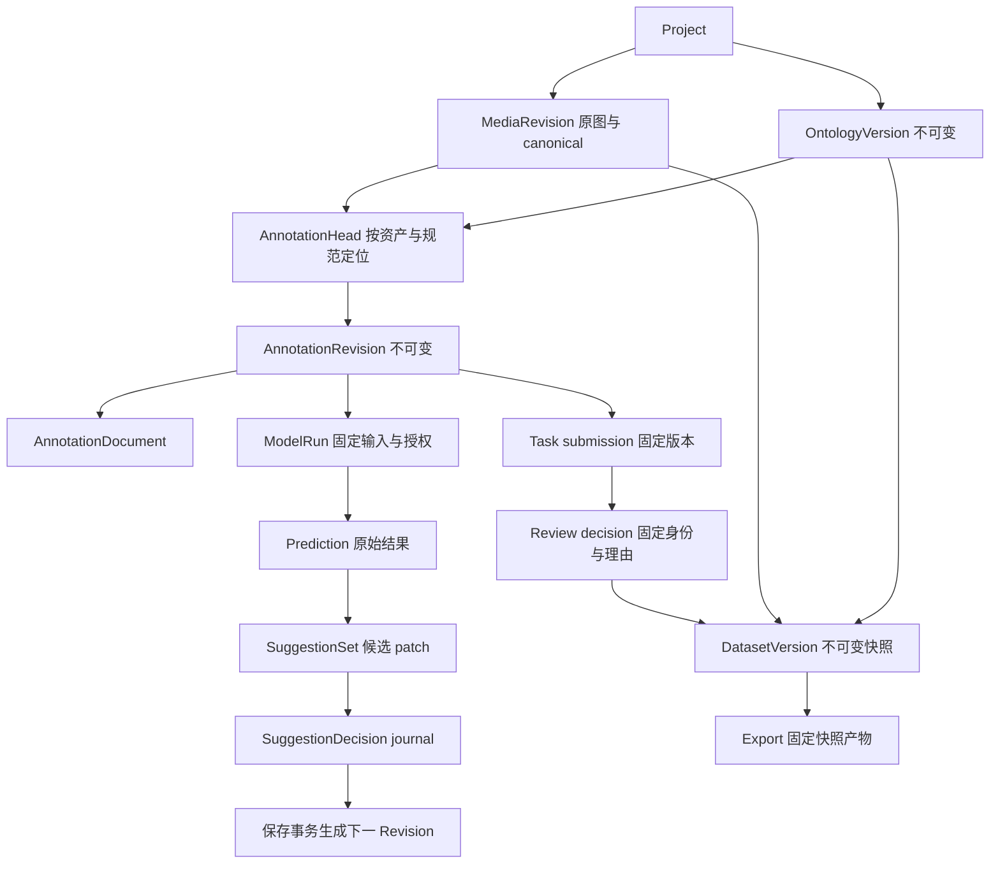

# 数据模型与生命周期

读者：内核、Web、API 与交付维护者。读后行动：追踪一份文档从媒体到草稿、保存、审核、快照和恢复，正确区分重放回执与新写入资格。本文核对当前 Rust 类型、保存事务、SQLite migrations、对象存储与 Web persistence；这是实现/契约说明，不是本轮产品运行或数据恢复证明。精确 wire 字段统一查[共享契约](contracts.md)，不在此重抄全部 schema。

## 实体与引用关系



Project 是权限范围，membership 是 user 与项目角色关系；platform_admin 不等于任意项目 admin。OntologyVersion 固定稳定 label_id、类别与属性定义；新规范不迁移旧媒体 head、任务或草稿。MediaRevision 固定资产、方向、canonical 尺寸与内容 hash。head 按 project/asset_revision_id/ontology_version_id 单独引用一个 revision，不是每张图唯一“最新规范”。

| 名称 | 标识/计数用途 | 不可替代的量 |
|---|---|---|
| asset_revision_id / ontology_version_id / annotation_revision_id | 固定实体身份 | 不能拿名称、时间戳、对象数替代 |
| generation | Native 编辑快照的本地代次 | 不是服务端 revision_no，也不是全局时间 |
| revision_no | 某 head 链中新 revision 的服务端序号 | 不是可直接作为 CAS base 的 ID |
| operation_id | actor + operation_kind 范围的幂等身份 | 不表示 document 内容 hash |
| content_hash | 已验证 Document 的实际 serde JSON 字节 SHA256 | 不是媒体 hash，也不是任意 JS JSON stringify 的 hash |
| object_hash | label、bbox、排序属性的投影 SHA256 | 不含 object_id/origin/显示 flags，不代表完整对象字节 |
| canonical_sha256 / original_object_sha256 | 对应媒体文件字节 | 原图和 canonical 必须分别比较 |
| dataset manifest_sha256 | 冻结 manifest 的身份 | 不是后来 ZIP、ZIP 内导出 manifest 的文件 hash |
| draft_id / write_token | 本地分支与确切持久记录身份 | 不授予服务端写权限或 task lease |

## original 与 canonical 方向

原输入字节不可变保留；API 检查 PNG/JPEG 后解码，统一 EXIF 1–8（包括镜像），生成 canonical PNG。媒体保存 original→canonical 的 3×3 矩阵、原方向与 canonical 尺寸；EXIF 6/8 会交换宽高。不能将浏览器缩放后的尺寸或原始 JPEG 尺寸当作 Document 坐标空间。

Document 使用 `canonical_image_pixels`，连续像素 bbox xyxy，左上原点，宽高不加 1。领域 f64，GPU 缓冲 f32；DPR 只影响 canvas 后备尺寸，不进入持久坐标。显示/预览不是重新定义几何基准。COCO/YOLO detection 导出对应 canonical 图片和坐标，不承诺变回原始 EXIF 方向；native 保留方向与来源材料。

## Document、Draft、Prediction、Decision、Revision、Review 与 DatasetVersion

| 阶段 | 发生的动作 | 保留与禁止混用 |
|---|---|---|
| Document | Native 命令创建/修改对象、属性、完成状态 | schema_version=1、固定 asset/ontology/coordinate_space；UI 不另建可编辑 bbox |
| Draft | 将完整 document/base/generation、pending 与 journal 写 IDB | 本地成功不等于远端成功；GPU 缓冲不是恢复材料 |
| ModelRun/Prediction | 固定已保存 revision、ontology、媒体 hash、范围、profile 与批准 grant 后执行 | 原始结果与事实文档隔离；unknown 用量不当作 0 |
| SuggestionSet | 校验候选 patch 与 before_hash，展示差异 | stale/取消不自动 rebase 或接受；模型不能直接写 Document |
| SuggestionDecision | accept/revert 随逻辑编辑进入有序 journal | accept 与更新 document 同一次保存事务；不从最终几何反推 journal |
| AnnotationRevision | 服务端验证并原子写不可变版本、推进 head | undo 已同步内容产生新 revision，不删除旧版本 |
| Task/Review | task 固定媒体/规范，submission 固定已保存当前 revision；独立批准/退回 | 保存不等于提交，提交不等于批准；理由、审核者与原版本保留 |
| DatasetVersion | 显式固定 revisions、ontology、类别映射、split 与审核材料 | 后续新 head 不改变快照，导出不读取“最新” |

完成状态为 unprocessed/in_progress/complete/confirmed_negative。空对象数组并不自动是负样本；confirmed_negative 要求 objects=[]。属性 null 与缺键不同，required 要求键存在，默认可为 null；历史文档不会因新默认被静默补写。prediction origin 必须经接受 coverage 核验；import origin 必须关联该项目/资产已提交 import batch，不能自己补一个来源 ID。

## 当前 UX 的状态边界

GUI账号创建普通平台用户，不授予membership。仅platform_admin读取全站账号和配置固定模型预设；仅project admin管理项目成员，角色互不提升。未知账号/成员POST只读观察，不能用同名或现有角色归因原请求。

固定revision只读视图钉asset/ontology/revision与父版本，不跟随head、不获得lease；明确打开当前标注才读head，缺目标/不匹配不fallback。Native拥有viewport；getViewport/get_viewport只读投影，focusRegion/focus_region仅取景，hitstack index/count来自最后完整Native点击。pointermove仅preview，pointerup有效提交才改document/generation与undo；DPR不入持久坐标。

Host固定预设是服务端执行配置元数据，管理员PUT只提交原configuration_hash，创建profile为not_run；公开投影和哈希不是秘密、真实运行证据或consent。历史不同配置禁止覆盖，未知PUT的只读匹配仅证明当前状态。

逐项拒绝存suggestion_rejection_operations与suggestion_change_rejections，operation绑定set/actor/有序change_ids，与accept/revert的suggestion_decisions分开，不推进head、不产生几何undo。已接受项先在annotation save撤销；接受被拒项返回CHANGE_REJECTED。未知拒绝核对原operation journal，不用汇总代替回执。

submit同事务写不可变submission、task=submitted，清lease holder/expiry并递增fence；返回lease_ended=true。GET submission核对真实lease，不按客户端时间猜。continue重验session、同review/actor/revision和分页本人open任务，查找阶段不写租约；显式继续的精准领取/导航须通过原上下文proof和task-open准备屏障。

DatasetVersion保存每批明确范围、排除理由、批准revision与split。网页用SHA-256(seed + NUL + source_group_id)前8字节big-endian模100整组80/10/10分桶，不保证实际数量比例；每批含排除≤1024且至少一项纳入，同组跨批同split。每批是独立快照；冻结不保证真实ZIP≤96 MiB，typed EXPORT_SIZE_LIMIT只在实际已知时报告字节。操作见[入门](getting-started.md)，wire见[API参考](api-reference.md)。

## Rust、API、IDB 与 renderer 的状态所有权

| 所有者 | 状态 | 持久/恢复边界 |
|---|---|---|
| Rust EditorCore | 可编辑 document、工具状态机、undo/redo、逻辑 delta | Web 只消费已接受 Native delta；本地 generation 跟随 Native |
| Rust API + SQLite | revision/head、任务/lease、审核、运行/预测/候选/decision、快照 | 每次请求重新验证权限与领域，不信 WASM |
| IndexedDB | 每标签页独立 draft branch、完整原请求/作者/outcome/journal/sources | browser origin 专属；不随服务端备份一起迁移 |
| React | 面板/搜索/请求展示与只读投影 | 不作为 bbox 或 server ACK 唯一来源 |
| renderer-wgpu | texture、instances、覆盖层和 GPU resources | 缓存，可重建；device lost 不丢业务文档 |

IDB 数据库 v2 的 draft_branches 以 `[asset_revision_id,draft_id]` 为键；其中 DraftRecord 的 schema_version 仍是 1。envelope 有 write_token、raw record、sources。draft_owner 和 pending_owner 是独立原作者元信息，不能用当前登录用户补齐。结构验证通过也不等于作者可信或 lease 有效。

读取/写入须等真实 IDB transaction complete；旧 scope、旧 install ticket、quota/abort 都不能签发当前 local certificate。“已保存本地”需当前完整记录的证据；服务端 ACK 后同样要完成最新本地记录事务，不能以旧 generation ACK 清掉后来 dirty。升级失败保留原 v1，未知 schema 保留 raw 救援，不正常化写回；JSON 编码失败不能生成假恢复包。

多个分支必须逐源显式选择；不能以 updated_at 选胜者、合并几何或自动重放旧 CAS。recover 需目标真正同步后才处理来源；显式 use_server 需目标完整本地提交后留档来源，archive 不等于上传。source token 不匹配、引用缺失/循环仍保留未解决/救援状态。新任务创建/claim 前后重读全部分支，不用 UI 当前单分支掩盖未知工作。

## 保存、候选 journal、CAS、幂等与 lease 的一次事务

SaveRequest 完整包含 operation_id、base_revision_id、document、lease（显式 null 或 task_id/fencing_token）、suggestion_decisions。防抖为 400ms；单标签页同 asset 单飞，切图不丢旧队列。prepare 后 pending.request 不可变，后续编辑等待这个请求的真实 ACK，不覆盖在途 body。

服务器按下列顺序处理普通保存：

1. 限制 32 MiB body、解析/验证 SaveRequest，计算包含 asset 路径与完整 request（包括 lease）的 hash。
2. 开始 SQLite 写事务；以 actor/operation_id/annotation_save 查幂等记录。
3. 已存在且 hash 相同：重新核对当前 actor 的项目写权限/资产，返回原 revision，idempotent_replay=true；hash 不同返回 409 IDEMPOTENCY_KEY_REUSE。
4. 新操作：验证资产/写权限及 task 固定 asset+ontology、holder、服务端 expiry、fencing，再验证 canonical 尺寸、ontology、几何、完成状态、import/prediction 来源。
5. base 必须等于该固定规范 head；对 base document 核验全部 decision journal，序列化并 hash document，插入 revision，记录接受/撤销决定，CAS 更新 head，写幂等 ACK，最后提交。

任一验证/CAS 失败整事务回滚，不留下半写 revision、head 或 journal。**已成功普通 save 的原请求 ACK 重放不要求原 lease 仍有效，也不再次推进 head；这不是新写入许可。** annotation import 先核对原 preview actor 与当前项目写权限；相同原请求已成功时返回存储 ACK，不重新验证当前 lease/fence/base。新 import 提交才检查当前写入资格，不能把成功历史确认与新提交混为一谈。

### 成功时序

```text
Native generation N + journal
  → IDB 当前完整记录 complete
  → prepare op A / base R7 / 原 lease / document N
  → API 单事务 revision R8 + decision + head + ACK
  → 收到匹配 A/R8 的成功回执
  → 最新 IDB 记录 complete + 当前 owner/scope 核验
  → 只标记已确认 generation/journal；N+1 仍 dirty
```

### 结果未知时序

```text
发送 A → 网络断开/回执无法确认 → 保留 A 的原 body/base/lease/journal
  → paused；只读 GET 可诊断，不能消除未知
  → 同一可信双作者、scope/epoch/install 仍 current 时显式确认原请求
  → 匹配成功 ACK → 最新 IDB complete → 可协调回执
  → 新写入另验当前 fixed task 的 fresh lease/Native/context
```

曾经 unknown 后收到 401/403/404/409/422，只说明这一次拒绝，不能证明第一次没提交。不得换 operation、换 lease 包装旧 payload、删 pending、refresh 清库或自动 rebase。canRetryRetained 只授权原 unknown/rejected 请求或实际 ACK 的本地提交屏障，不授权 prepared 未发请求、无 pending 的 paused future 或新编辑。generic flush/timer 不会解除这些屏障。

### 明确冲突时序

```text
新 op B/base R7，但 head 已 R8 → 409 REVISION_CONFLICT → 回滚
  → 保留本地分支并查看 R8 / 下载救援
  → 操作者显式解决；不强写、不用新 base 偷改原未知请求
```

新鲜请求被明确 lease 拒绝且从未 unknown 时，只有精确重新领取同一 fixed task/asset/ontology 的有效 lease，并核对当前 Native/context，才可显式 reprepare 新 operation；仍保持编辑屏障到实际 ACK。本次 lease 明确拒绝与历史 unknown 是不同资格。LEASE_NOT_REQUIRED 表示无任务却携带 lease；LEASE_REQUIRED/NOT_HELD/EXPIRED、STALE_FENCING_TOKEN、TASK_NOT_OPEN/TASK_ONTOLOGY_MISMATCH 均不能只靠 CAS 绕过。

## 固定审核、快照与信息损失

任务状态 open→submitted→closed（批准）；退回后任务重新开放，旧 submission/decision/issues 不删除。提交序列锁定编辑，flush 后读取并提交确切当前已保存 revision，期间不得插入本地修改。审核查看固定版本相对 parent 的差异，批准/退回绑定同一 revision IDs 和非空理由。默认不自审；团队身份配置见[运维](operations.md)。新 head 不继承旧版本批准。

快照固定 ontology、媒体/revision IDs、内容 hash、类别有序映射与 train/val/test；不按同名推断 ID。source_group_id 辅助划分不能拆同源组。native 保存无损业务材料；COCO/YOLO detection 的属性、身份、来源、完成/审核等损失按实际 loss 报告显式确认，COCO segmentation 不能静默丢弃。单图 COCO 是 JSON，数据集导出是 ZIP，两者回读工具不能混用。操作步骤与独立回读见[手工验收](manual-smoke.md)。

## 对象存储、备份、恢复与保留

SQLite 使用 WAL、foreign_keys、5 连接池及受限写 timeout，按版本登记 migrations。对象按文件 SHA256 存到 `objects/<前2位>/<次2位>/<完整hash>`；先 staging、durable publish，再建立数据库引用。文件系统与 SQLite 不假称跨存储原子，不能从未引用文件存在推出媒体/导出提交成功。

一致性备份使用 SQLite backup，并复制固定数据库引用的媒体/单图导出/数据集导出对象，校验 hash/schema/integrity。它不是热运行时简单复制 api.sqlite；也不包含浏览器 IDB、私人 Host JSON、官方 CLI home 或权重。备份 scrub 会清 session/密码和配置凭据、consent/授权；保留业务 ID、不可变 revision、审核人/理由及快照。credential 与不可变业务文本碰撞时 fail closed，不重写历史来伪造可恢复包。

restore 只写不存在的新目录，检验 manifest 和 shipped migrations，失败保留目标供诊断；启动恢复目录后 API 才给一次性恢复码，生成新的 restore-admin 身份，不改历史审核归属。对象 hash 一致、旧 revision 与冻结引用可读取、fresh 身份可正常登录才是恢复成功观察，非仅 restore_created。完整保全与禁止动作见[备份恢复](backup-restore.md)。

当前没有承诺自动清理不可变历史的保留期或用户配置的 GC 入口；不要手删对象、审核或 revision 来“释放空间”。本地草稿救援包标明 unsynced，不是已审核交付或整项目备份。设备/存储/网络失败的恢复须保持上述身份、原请求和证据边界。
