# 本地开始使用

这份指南带你在自己的电脑上完成登录、导入图片和人工标注。想先试用，可以下载下面的预发布包；想修改代码，再看文末的源码构建步骤。人工标注不需要模型账号，团队审核则需要另配有审核权限的账号。

遇到保存失败或冲突时，先保全本地草稿，再按[故障指南](troubleshooting.md)处理。支持范围见[已知限制](known-limitations.md)，实际验证记录见[报告索引](../reports/index.md)。

## 下载预发布包

[v0.1.0-rc.3](https://github.com/lona-cn/weblabel/releases/tag/v0.1.0-rc.3) 提供 Windows 和 Linux x64 便携包，内含 Node 和应用程序，不需要从源码构建。这是供试用的预发布版，不是签名安装器；真实模型和目标硬件的完整验证仍未完成。

下载与你的系统对应的压缩包和同名 `.sha256` 文件，把它们放在同一目录。先核对校验值，再解压。以下命令在下载目录运行。

Windows（PowerShell）：

```powershell
Get-FileHash .\weblabel-0.1.0-rc.3-win32-x64.tar.gz -Algorithm SHA256
Get-Content .\weblabel-0.1.0-rc.3-win32-x64.tar.gz.sha256
```

比较第一条命令的 `Hash` 与第二条输出开头的 64 位校验值；后面的文件名不用比较，字母大小写可忽略。不一致就停止，不要启动这个包。

Linux：

```sh
sha256sum --check weblabel-0.1.0-rc.3-linux-x64.tar.gz.sha256
```

应看到对应文件的 `OK`；校验失败就先停止。将整个压缩包解压到可写目录，在解压后的目录打开终端，Windows 执行 `.\launch.cmd`，Linux 执行 `sh ./launch.sh`。不要只取出某个可执行文件。

启动后打开终端显示的网页地址，按下面的步骤登录。保持终端开启，用完按 Ctrl+C 停止服务。包内 `BUNDLE.md` 说明运行要求和维护命令；`release` 是程序文件，不能修改。

启动器默认把数据放在**运行命令时所在目录**的 `data` 下。上面的步骤从解压目录启动，因此数据也在那里。请记住这个位置，升级前先[备份](backup-restore.md)。不要删除运行中服务的 `runtime.lock`。

换程序版本后，用 `--data-dir` 指向原来的数据目录，例如：

```powershell
.\launch.cmd --data-dir "D:\WebLabel数据"
```

```sh
sh ./launch.sh --data-dir "/home/你的用户名/WebLabel数据"
```

把示例路径换成你原来数据目录的完整路径，不需要搬动数据。路径含空格时保留引号。

## 先打开已启动的本地服务

如果本地服务已由你或管理员启动，直接打开启动终端显示的 WEBLABEL_LOCAL_URL（默认 http://127.0.0.1:48100），继续下面的网页步骤。不要把私有 API 端口当浏览器入口，也不使用公网地址。首次设置只需从启动终端复制一次性启动码，**不用另开 PowerShell、执行 HTTP 命令或初始化脚本**。

尚未启动服务时，可以先使用上面的预发布包；需要修改代码或自行构建时，见文末[开发者：从源码准备本地服务](#开发者从源码准备本地服务)。

浏览器编辑需要真实可用的 WebGPU。建议先用 Windows x64 桌面 Chrome / Edge；没有 WebGPU 时只能查看或诊断，不能编辑。Windows/Linux 便携包的启动与保存验证，不代表所有操作系统和显卡组合都已通过浏览器编辑验收；模型配置也不等于真实模型验收。

## 首次登录与人工标注

### 1. 在网页设置本地账户

1. 打开终端显示的 `WEBLABEL_LOCAL_URL`，默认 `http://127.0.0.1:48100`。不使用公网地址。
2. 空数据库第一次启动会在本地终端显示一次性 `WEBLABEL_BOOTSTRAP_CODE`，十分钟有效、仅能兑换一次。页面自动显示“首次设置本地账户”：复制启动码，设置密码并再次确认，再点击“设置并进入”。无需输入用户名，也不需要另开终端调用初始化 API。
3. 密码按 UTF-8 为 12–1024 字节；中文可能占多个字节。两次密码必须完全一致，首尾空格是密码的一部分，不会被去掉。启动码只去掉首尾空白；不要把码或密码放 URL、日志或截图。成功会直接进入项目页，显示实际用户名；普通新库为 `local-admin`。请保存用户名，之后使用设置的密码普通登录。本版本没有公网注册、在线自助找回或 SSO；本机操作者的管理员恢复见[运维说明](operations.md#管理员密码恢复)。

页面显示“启动码当前不可用”时先“重新检查”，不能认定一定过期；也可能是另一窗口正在兑换。若仍需设置且没有其他窗口正在提交，在启动终端按 Ctrl+C 停止本地服务，再用原数据目录重新启动并使用新码，不删除数据库或项目数据。已有正常账号的重启不会再输出码，页面直接普通登录。

收到初始化成功响应但会话未核实时，只使用“重新检查会话”，不要再提交启动码。网络错误或成功响应无法解析也先重查，不能据此认定账户未创建。如果页面核实已有身份却未取得有效 CSRF，按提示在浏览器中**仅清除此本地站点的 `weblabel_session` Cookie**，再用实际用户名和已设置密码正常登录；不要清项目数据或 IndexedDB。状态读取故障显示错误和重查，不假装是普通登录。

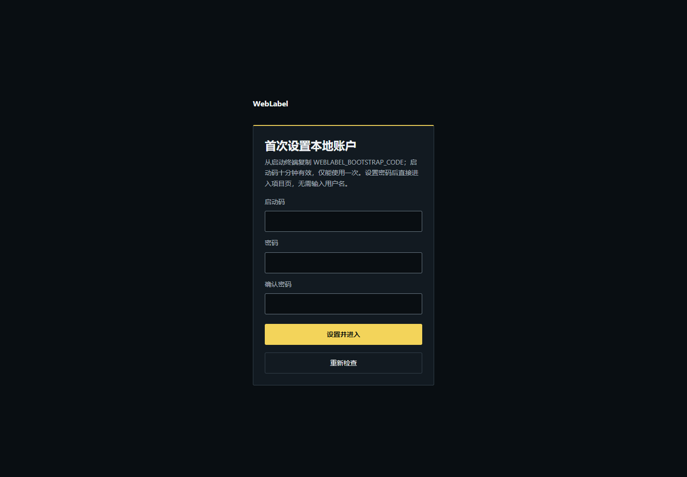

### 2. 新建项目并发布类别规范

新建项目并发布类别/属性规范。可添加多个稳定ID类别，设置名称、颜色、快捷键、enum/boolean/number/text属性、默认值、必填、枚举值、数值范围和指南。枚举选项与数值范围直接在对应属性行配置；只读默认值预览不创建几何，窄屏时字段按列排列。必填要求对象保存时存在该属性键，默认值可以是null；枚举空行是空字符串选项，不会被trim。项目管理员可从“查看规范”复制旧版并显式发布不可变新版本；新版本不自动迁移旧图片、任务或本地草稿。

项目创建已确认但规范被拒绝时，表单保留输入，“仅发布规范”不会重复创建项目。创建结果未知时只读核对，同名候选不能证明属于本次写入。发布结果未知且存在固定基线时，界面直接显示基线与保留草稿的只读差异，禁止切换版本或再次发布；只读核对找到相似版本也不能证明它属于本次写入。若已收到发布确认但后续读取失败，页面会区分“已确认”和“结果未知”，仍只允许核对，不自动重发。

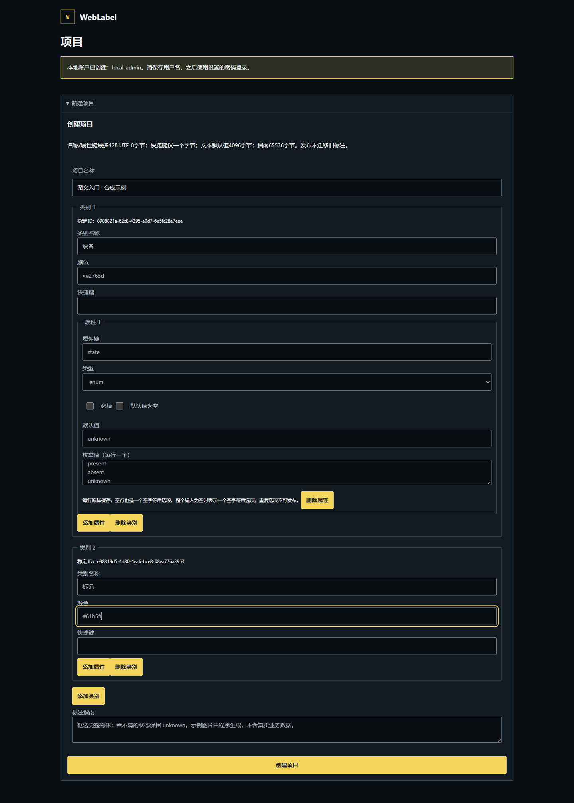

### 3. 上传图片并等待处理完成

在项目中选择静态 PNG/JPEG 并上传。导入静态PNG/JPEG后等待后台媒体作业完成，打开媒体时明确选择已有head的固定规范，任务或显式版本优先。指定媒体已不可读取时不会跳到第一张图片；“下载本地草稿”保留原document、pending请求与journal，不解除暂停。

项目尚无图片时，桌面工作台的图片栏直接显示原有媒体选择和上传控件；紧凑布局先打开“图片与对象”抽屉。选择文件本身不会上传，明确点击“上传媒体”后等待逐文件结果。未导入图片时没有标注保存记录；图片已导入但标注文档尚未载入时，服务器确认状态为未知，不能当作已保存或已完成。

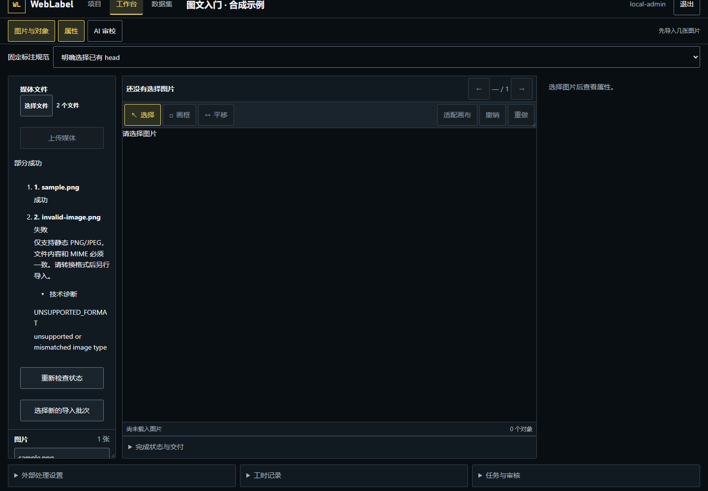

### 4. 在 Native 工作台编辑并确认保存

打开资产工作台。只有 WebGPU 的真实 device 显示 ready 后才可编辑。先从“绘制类别”选择稳定ID类别；重复名称以规范中的序号区分。画框、选择并修改类别/属性，一次拖动一个undo。多选后“选中对象改类”整批提交：任何锁定对象会拒绝整个批次；同类重设不改属性，换类按目标规范保留兼容值、去掉无效键、补声明默认值，整批一个undo。

   对象名称为类别加文档序号，例如“主体 #1”；检索名称/类别/ID和按类分组只改变显示，不清除原生选择或修改文档。隐藏仅影响显示，锁定阻止原生命令。紧凑布局选中对象后，画布下方显示只读选择摘要，可从“打开属性”进入原有属性抽屉；单选摘要区分可编辑、只读与锁定，多选显示实际数量。抽屉打开时背景画布不可交互，轮廓保留但编辑手柄隐藏；关闭后恢复原选择。单选可编辑canonical像素x/y/w/h，Enter或“应用完整几何”一次提交整框；切图、换选择和undo/redo取消未提交几何，不在blur分四次写。

   number属性保留逐字符输入（如0.或-），Enter/离开字段才校验有限数字及范围；空输入不转换为0或null，null需要明确按钮。错误输入保留供修正，不产生保存或undo。属性视图内按 Esc 会先取消未提交的几何或属性输入，焦点移到其他字段或几何按钮时也如此；没有待取消内容时，Esc 关闭抽屉并返回触发控件。规范、对象、选择、Native generation或编辑资格变化会取消陈旧输入；text的空字符串与null、boolean的false与null仍分别表示。

   焦点在画布或对象列表时，V/B/H切换选择/矩形/平移，Delete/Backspace删除当前原生选择，Ctrl/Meta+Z撤销、Ctrl/Meta+Y或Ctrl/Meta+Shift+Z重做，按住Space临时平移、松开恢复原工具。文本/IME、项目导航、审核和AI控件不触发编辑快捷键；按钮的Space用于激活。重复/保留快捷键只警告并不绑定；规范定义本身仍合法。设备未就绪、服务端只读预览或审核提交中禁止原生命令。等待远端保存确认，不把本地保存当远端ACK。
   “帮助与休息设置”展开快捷键、当前图片与固定规范、绘制类别及休息选项。自愿休息提醒默认关闭，仅在当前页面生效；暂停编辑不释放任务、不停止保存、不延长 lease。关闭帮助恢复打开时的滚动位置，触发控件仍可聚焦时归还焦点，并保留本页的暂停与提醒选择。
正常保存只显示本地提交与服务器确认，原始凭证在技术详情中。保存、完成状态和完成操作紧邻状态；选择“已确认无目标”后，必须检查空图片并明确勾选确认，空文档本身不代表无目标。短屏可滚动到操作区。仅打开或重载产生的无主、无待处理只读快照保留在“项目保存队列”的折叠留档中；不是损坏警报，不认领原作者，也不能用于恢复或取得写权限。未知请求、未同步、失败、暂停或坏结构仍保留处理/救援入口。
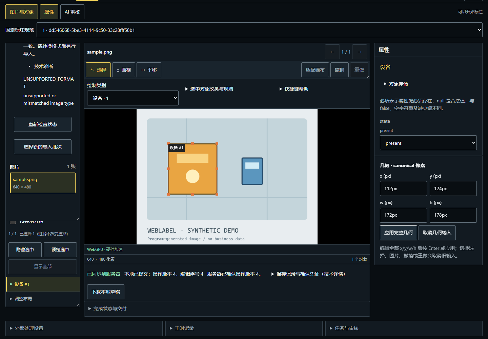

### 导入已有标注与单图版本导出

媒体作业逐文件显示输入位置、成功/失败/中断/未确认及稳定错误码。同名文件以位置区分；终态部分成功不会被总状态掩盖。排队或运行状态可显式“重新检查”；未知上传不要自动重传。

在工作台点击“导入图片 / 标注”或展开“媒体导入、标注导入与固定版本导出”，再选择“展开标注导入”查看大尺寸配置和预览。Native、YOLO 与 COCO 使用同一组选项；COCO 必须选明确 image ID 且逐类别映射稳定 label ID，YOLO 按 class index 从 0 开始明确选择有序、唯一 label IDs，名称相同也不推断对应。预览调用真实服务、固定媒体/规范/base/lease，但不改变 head。只读框显示类别和对象序号；超过 100 个对象时仅显示前 100 个文字标签，全部框和实际文档仍保留。外部 bbox 新对象按实际目标类别全部声明默认值创建，包含 optional 及 null；“规范默认属性”是新增的目标默认值，不是从来源还原属性。仅实际对象有这些值才报告该损失，native 已有属性不被补默认值覆盖。返回工作台不会取消已生成的预览或已勾选的损失确认；可明确“取消预览”释放预览锁。范围变化或页面卸载仍遵守原有范围锁和未知请求保留规则。

下图为早期内嵌式导入界面的真实滚动拼接图，不代表当前展开视图同屏效果。点击图片可放大。

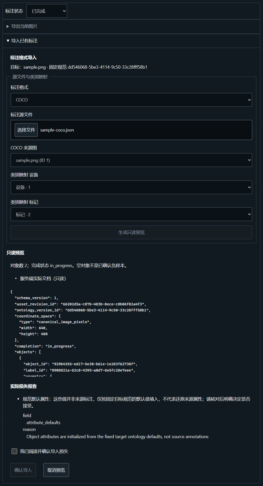

阅读服务端实际文档和全部loss后明确勾选，再“确认导入”。导入以lease/fence、CAS和幂等提交，采用实际返回的不可变revision；预览及未确认提交期间暂停原生编辑、旧保存和导航。不能把匹配head或文档猜成ACK。原生包保留单图文档、规范、媒体方向和来源，不是整项目备份。

单图导出位于同一“媒体导入、标注导入与固定版本导出”区域的“导出当前图片版本”，固定已保存 revision 后检查所选 native/COCO/YOLO 的实际 loss。YOLO/COCO 可能丢对象 ID、属性、来源及完成状态；明确勾选才继续，不把空框当 negative。改格式或固定版本撤销旧确认；已确认旧产物只作为独立救援下载，不覆盖当前选择和新 loss。产物已创建而下载失败时“重新下载已有产物”只 GET 同一产物，不重建导出。未确认操作保留原 operation/payload，不能凭后续一次拒绝推断首请求从未提交。导入/导出 outbox 保留于当前页面模块并跨组件卸载；不宣称整页 reload 持久化。

### 团队审核前提

这是高级团队流程的前提，**不是首次登录、上传或普通人工编辑的要求**。全新数据库通过网页首次设置后只有 `local-admin`，不会自动创建第二个人。项目默认 `allow_self_review=false`，禁止提交者审核自己的版本；完成固定任务提交、独立审核并冻结已批准数据集前，必须预先配置不同的标注者与审核者账号及其项目成员身份。只有一个账号时可以继续人工编辑和保存，但不能把自审核、未批准版本或未冻结范围当作交付成功。

已有管理员按[配置团队审核账号与成员](operations.md#配置团队审核账号与成员)完成普通密码登录、身份核实、创建独立 reviewer、授予项目成员并核实新审核者网页登录；不要把这套高级管理步骤加入普通首次登录之前。

项目页提供“平台账号管理 / 准备独立审核身份”和所选项目的“项目成员”。平台管理员填写用户名和密码，点击“创建普通账号”，记录实际 user_id；新账号没有平台管理员或项目权限。项目管理员读取项目成员，明确选择现有账号或填写已核实的 user_id，再选择 admin / annotator / reviewer / viewer 并设置成员。仅平台管理员可读取全站账号；仅项目管理员可设置成员，两种角色互不授予。创建结果未知只读核对，同名不能认领原请求；成员结果未知只核对实际目标角色，不自动重发。独立审核者随后正常登录并核实项目角色。普通首次人工编辑不需要先完成这套团队管理。

管理员完成预配置后，任务面板的“刷新可选成员”只读取已有项目成员，**不会创建账号、添加成员或授予权限**。以下团队截图使用 `local-admin` 提交、管理员预先配置的 `demo-reviewer` 独立审核；`demo-reviewer` 不是默认账号，没有默认密码。请使用管理员实际配置的身份与凭证，不要照抄截图账号来登录。

### 5. 领取固定任务并同步提交

展开“任务与审核”，项目管理员明确选择图片、规范与实际标注者创建固定任务，被指派者点击“领取任务”。保存要求有效本人lease/fencing token，每20秒续期，60秒未续期失去新写入资格。创建未知只读核对；领取或清理release未知时保留固定目标与草稿，仅GET刷新任务。任务列表不返回holder/fence/expiry，刷新不能证明未知租约写入结果，因此不能解锁、再领取、续期或继续下一任务，不凭本机等待猜lease已结束。
曾关联任务的图片，从普通入口只读打开。开放待办请在任务区显式领取；已结束任务的图片需项目管理员明确新建任务再领取，不能直接修改批准版本。若先前已收到 TASK_NOT_OPEN，先下载原始草稿/请求并通过 GUI 明确留档，再开始新任务；原 unknown/paused payload 不换 operation、不自动重放。任务读取尚未确认或失败时只读，不先放开编辑让保存碰壁。
完成编辑后先展开“完成状态与交付”，明确设置“已完成”；确实没有目标才设置“已确认无目标”，空文档本身不是 negative。再到“任务与审核”点击“同步并提交当前版本”，等待远端保存 ACK，再提交确切的不可变 revision。未确认保存、冲突或失效租约不能当作已提交；本地保存不等于远端提交。

下图是已领取任务、提交前的操作界面；确认完成状态后，使用“同步并提交当前版本”。独立审核者已由管理员预配置。

任务与审核长图同样来自实际 200px 滚动工具区的正常滚动，逐帧真实截图按顺序拼接、未改页面内容，并非同屏展示；点击图片可放大。

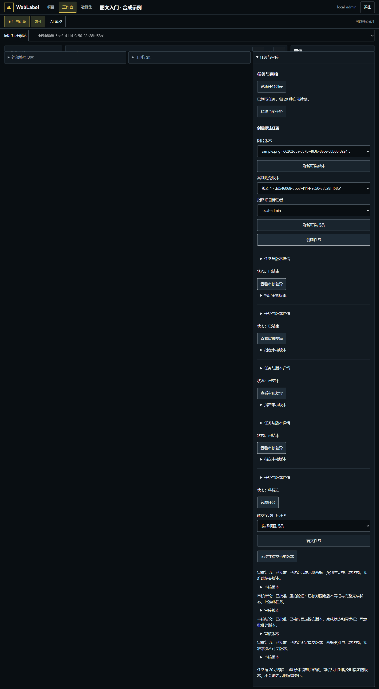

提交同事务改task=submitted、清holder/expiry并递增fence，返回lease_ended=true，不额外release。未知提交只读核对task/actor/唯一revision/review与实际lease_ended，不重submit。“继续下一个已指派任务”的查找阶段仅GET session、原固定submission和分页任务，返回本项目本人open的另一任务及原上下文证明；之后通过既有准备屏障，在显式继续动作内才允许精准领取和导航。原文档/generation/本地保存凭证/Native host/加载目标/scope/权限epoch须在准备前后仍相同；准备或领取异步期间任何变化均停留原上下文。未知租约写入围栏存在时禁止继续；不能把GET刷新说成未知acquire的回执。

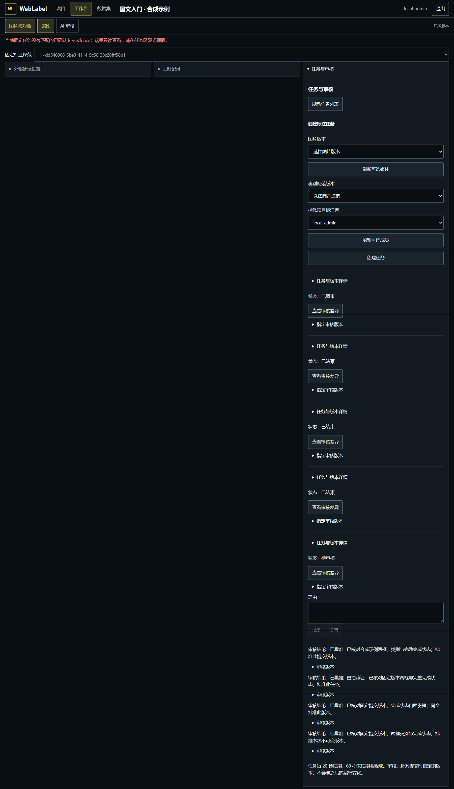

### 6. 审核指定 revision

满足[团队审核前提](#团队审核前提)后，由与提交者不同、具有该项目审核权限的操作者登录，在待审核任务中点击“查看审核差异”，核对“指定审核版本”、相对父版本的对象变化与完成状态，填写理由后点击“批准”或“退回”。审核绑定提交时指定的不可变 revision，不跟随之后的 head；新编辑不能继承旧版本的批准。

“查看审核差异”展开同一份固定版本只读投影和原有审核理由、决定控件。关闭或按 Escape 返回任务队列并保留未提交理由，不自动提交审核；批准后若该任务从当前队列移除，焦点返回“待审核”导航。

下图保留旧布局下批准前的审核操作记录；当前“查看审核差异”会展开大视图，不再要求沿长面板滚动。预配置的 `demo-reviewer` 核对 `local-admin` 提交版本、填写理由，再明确点击“批准”。

审核者没有编辑 lease，因此画布只读／写入暂停不等于审核批准失败；以下长图沿用上述真实滚动拼接取景，点击图片可放大。

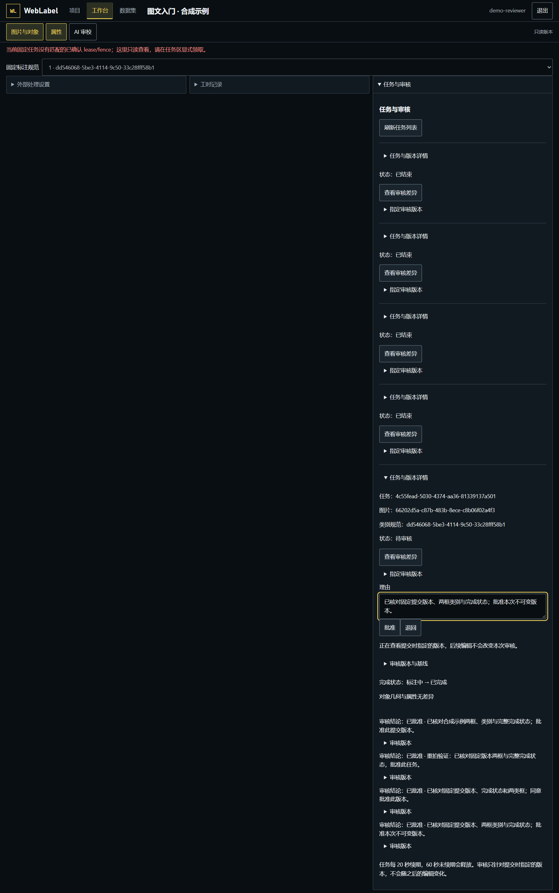

批准得到确认后，核对该指定 revision 的已批准结论。此时批准表单不再显示；下图是批准后的结果，不是仍可执行批准的表单。批准只适用于该固定版本，接下来仍需显式选择数据集范围并冻结快照。

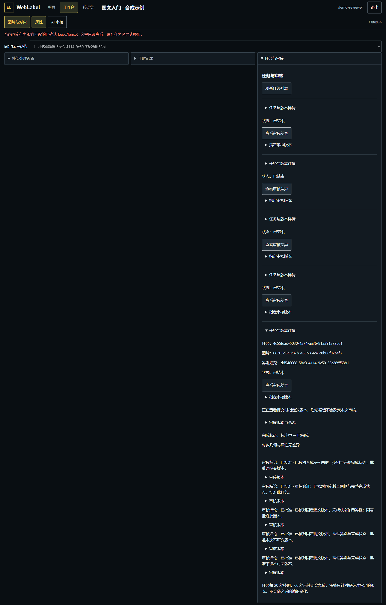

### 7. 显式选择范围、冻结快照并导出

打开“数据集与导出”，明确选择类别规范版本，再点击“浏览图片与标注摘要”。按页浏览；需要交付的图片选择 include，不交付但需记录的图片选择 exclude 并填写原因，其他保持范围外。未浏览或范围外不会自动处理。直接冻结时纳入与排除合计最多 1024 张，至少纳入一张；较大已选择范围可先按下面的计划分批，不把全项目自动视为交付范围。

每张纳入图片可明确选择 train / val / test；同 source_group_id 的图片保持同一 split。需要确定性计划时填写非空 seed（默认文本 17），点击“预览整组划分与分批范围”，检查每批精确 ID、纳入/排除和 split，再点击“确认整组划分”。SHA-256 对 seed + NUL + group 分配 80/10/10 桶，实际数量不保证比例；同组可跨批但 split 相同。每批含排除最多 1024 项且至少一项纳入；纳入不足以分摊到每批时需明确调整范围，不静默丢项。选择当前交付批次，检查冻结摘要，再次确认冻结。只有固定规范、已批准且 complete 或 confirmed_negative 的实际 revision 可纳入。记录每批快照编号，逐批独立导出；冻结后范围不可原位改写。项数预算不等于体积，96 MiB ZIP 限制仍由服务端实际检查。

选择 native / COCO / YOLO，点击“生成导出并检查信息损失”。阅读本次数据集导出的真实 loss；需要确认时勾选“我已阅读并明确接受上述信息损失”，再点击“确认损失并生成导出”。原生格式用于无损交付；COCO / YOLO 标签省略属性、对象 ID 和来源，具体损失以实际报告为准（当前 YOLO 报告字段为 `annotation.attributes`、`annotation.object_ids`、`annotation.provenance`）。完整数据集 ZIP 的 `manifest.json` 仍保留完成状态、批准元数据和固定 revision，不能把标签省略这些信息说成整个 ZIP 丢失完成或批准信息。此边界仅针对数据集交付；单图导出仍按其自身实际 loss 判断。等待已有作业完成后“下载数据包”；下载失败只重新下载已有产物，不新建作业。

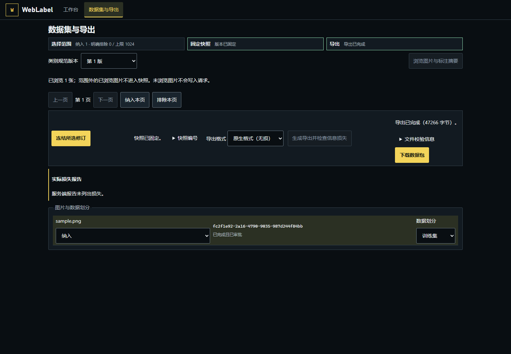

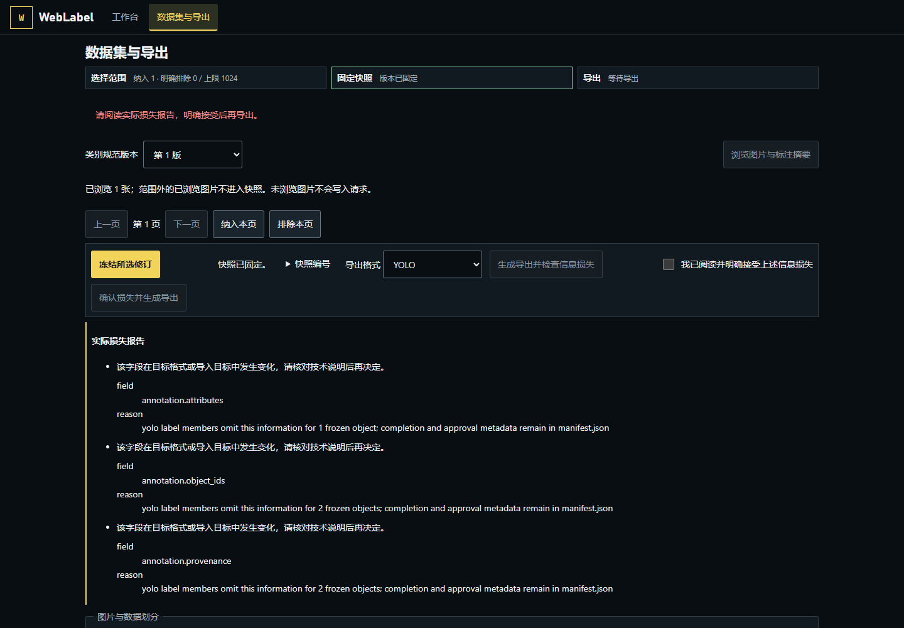

冻结或导出 POST 结果未知时，不自动重发，也不用新 operation ID 重新创建。保留原 operation/payload，按页面显式“重放同一原始请求”；范围不一致时先“恢复原请求固定范围”。已有作业只“重新检查已有作业状态”。后来一次拒绝不能证明首请求未提交。

### 固定版本、取景与 AI 审校

从指定 revision 入口检查固定图片/规范/版本，页面只读且不跟随 head；缺目标或不匹配显示错误，不跳到第一张图片。批准/退回仍在任务审核队列。“打开此图片的当前标注”明确离开历史版本后重新读取当前 head。

固定版本页面直接显示项目、图片、规范、revision 和父版本凭证；有父版本时列出变化字段的前后值。选择对象可查看只读属性和 canonical xyxy，定位只改变只读投影；没有父版本时明确说明无法比较，不把整份文档当作新增差异。

取景控件从 Native getViewport 读取实时缩放/平移；适配画布、聚焦选中对象或 AI 候选区域只改变视口，不保存几何。重叠框命中顺序与位置由 Native hitstack 回执显示，不按 DOM 猜框。pointermove 只预览，pointerup 才形成一次有效文档命令与一个 undo；取消无提交。

平台管理员打开“AI 审校”中的“服务端模型配置”，读取本机操作者已准备的固定 Host 预设，明确选择后保存。网页只提交 configuration_hash，不接收秘密、路径、启动参数；不会登录、下载权重或运行模型。空列表/配置不可用时继续人工标注。写入未知时只读 GET 原 profile，比较 profile/provider/model/auth/capabilities 和哈希；404 仍可能在途，不能自动重写。静态 ready/not_run 不是 live_passed，项目策略和逐次 preview/consent 仍必需。

在工作台的“AI 审校”侧栏选择“展开配置与提示”，可在大视图同时查看当前图片、已选对象的只读 canonical 轮廓、完整 model_id、配置/验证状态、三个任务和指令。未选对象时范围为当前版本全部对象；实际外发范围仍以服务器授权预览为准。关闭或按 Escape 返回原侧栏，保留选择和输入；确认运行范围只进入授权预览，不自动开始模型运行。

具有项目写权限者对已运行产生的固定建议逐项查看差异，可拒绝单项或选中项；拒绝独立持久化 journal，不改正式文档、不产生几何 undo。接受/撤销仍通过 Native 命令和 SaveRequest 同事务。已接受项先撤销并确认保存才能拒绝；拒绝项后续接受返回 CHANGE_REJECTED。未知拒绝保留 set/operation/有序 change_ids，只读查询同一 operation 的完整 journal，不重新 POST，不凭汇总 rejected IDs 当原请求确认。本轮未授权真实账号或模型运行；完整接口见[API参考](api-reference.md)。

产生建议后可选择“展开候选对照”：每组在一张只读 canonical 图上显示原值虚线与建议值实线，并保留逐项属性差异、局部定位和拒绝；重合轮廓也能同时辨认。勾选、采纳与拒绝仍使用原有候选状态和决策流程，不会因打开对照而自动运行模型。选择“定位主画布”返回真实编辑画布并聚焦相应区域；普通关闭或 Escape 返回原入口，保留当前选择。

运行开始后，AI 检查器先显示实际运行状态、事件和取消入口；关闭或切换检查器不会取消运行。事件可在其区域内滚动，费用未返回时仍为未知，取消不保证上游费用停止。

### 8. 下次使用密码登录

已有正常账号再次启动不会打印启动码。打开同一本地入口，填写保存的实际用户名与原样密码，点击“登录”，无需 PowerShell 或初始化 API。普通全新库的用户名是 local-admin；从备份恢复的新管理员是 restore-admin-<新UUID>，完整保存成功提示中的实际值，旧密码与 session 不沿用。忘记已有管理员密码时，使用[本机管理员密码恢复](operations.md#管理员密码恢复)：它只更新指定管理员的密码，不创建新身份；普通用户没有在线自助找回入口。

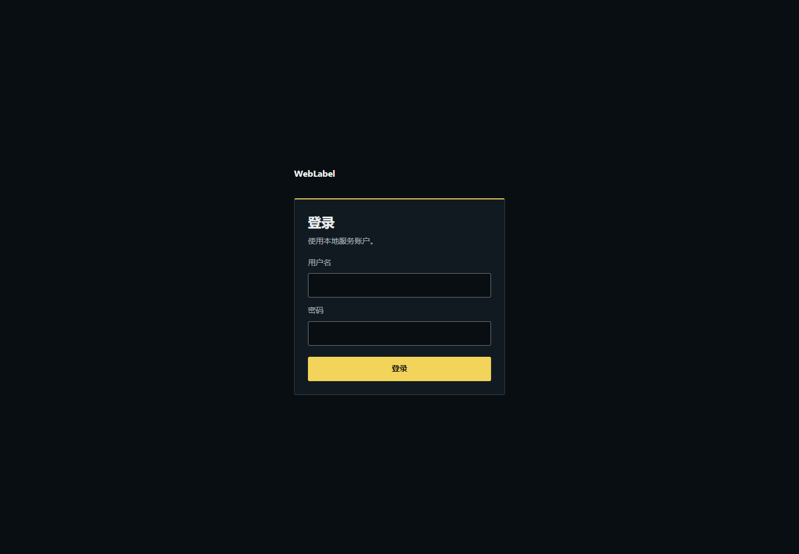

### 工作台布局与状态反馈

工作台以画布为中心，保存和完成状态留在画布下方。桌面默认显示左侧图片与对象、右侧属性；顶部“图片与对象”“属性”“AI 审校”可打开、切换或收起对应侧栏。AI 配置不与属性同时铺开。宽度不超过 1099px 时，侧栏改为覆盖式面板，不把画布和当前任务推到页面下方；关闭按钮、Escape 或点击遮罩均可关闭，焦点回到对应入口。跨断点时也保留可继续操作的焦点。

图片列表与对象列表分别滚动；“调整布局”不会被对象行覆盖。桌面侧栏宽度为 220–360px，图片列表高度为 94–260px，工具栏高度为 44–160px；达到边界时相应按钮禁用。窄屏固定侧栏宽度，不显示无效的宽度调节。切换侧栏不重置选图、对象选择或 AI 输入。调整窗口或缩放后，可用“适配画布”重新取景。

明黄色表示当前选择和主要操作，青绿色表示已确认，珊瑚色表示错误；各状态仍有文字说明。“已同步到服务器”才表示远端保存成功，“已保存到本地，待同步”不代表服务器确认。WebGPU 不可用、设备丢失或恢复中时，画布中央显示诊断卡；丢失后可显式重试，恢复前不可编辑，同一 CPU 文档和撤销历史保留。展开“GPU 诊断”可查看完整错误码、消息和请求 ID；不启用 Canvas2D 回退。

项目页先显示项目列表；成功空态表示当前账户没有可访问的项目，不代表服务中不存在其他项目。创建表单不会自动打开；可明确点击顶部、空态或列表下方的“新建项目”入口，返回时优先将焦点归还所用入口，不可用时回到仍可用的创建、草稿或重新读取入口。列表读取中或失败时不能判断是否为空，也不能创建；已输入的草稿可查看，重新读取成功前不能提交，错误原文保留在提示中。数据集页将读取、冻结、生成与下载放在列表前的操作区，长列表在自己的区域内滚动；当前阶段的主操作突出显示，信息损失仍须明确确认。

“外部处理设置”“工时记录”“任务与审核”和“导出当前图片”按需展开；键盘可用 Tab 聚焦标题，再按 Enter 或 Space。折叠不卸载面板或取消运行；保存失败、冲突恢复和标注完成状态仍直接可见。工时恢复操作位于“工时记录”内，展开后操作。长编号、类别规范和诊断原文放在详情中，授权范围、外发风险与信息损失确认不会省略。导出成功后的损失报告可通过“查看信息损失报告”展开。

工时默认关闭，保存到项目服务器必须明确点击。可单独选择“本段关联当前任务”和当前图片/规范匹配的已知AI运行；不选择就不关联，切换会封存旧段，历史记录不补当前ID。运行结果页分开显示精确提交版本审核关系、本人明确记录的运行/任务工时与未知费用；这些记录不是完整工时、准确率或ROI。
在“自愿工时与运行摘要”中可选择“展开工时与运行摘要”，同屏查看自愿工时和当前图片、规范匹配的运行状态与结果。切换到不匹配的图片后不沿用旧运行摘要；未记录的工时与费用仍为未知。展开或关闭不会开启工时统计、开始运行或自动上传，返回时恢复原焦点和滚动位置。
“数据集与导出”依次显示范围、固定快照和当前格式的导出状态。修改范围、标注版本、类别规范或划分后，需要重新固定快照；上一次导出成功不代表新范围已交付。快照要求指定版本已获审核批准。YOLO / COCO 的信息损失先展示说明，报告原文可展开；明确勾选确认后才能继续导出。

恢复数据库保留历史用户与审核身份，但不继承旧登录。restore 完成后用原生 serve 显式启动新恢复目录，终端才打印一次性 `WEBLABEL_BOOTSTRAP_CODE`。在网页设置新密码，保存成功提示里的实际 `restore-admin-<新UUID>` 用户名；不重新初始化旧身份。

当前 v2 按 Ctrl+C 正常关闭 Rust 服务、撤销能力并回收属于本次原始 OS 所有权的子树，再关闭数据库和释放 OS 锁；sidecar 文件保留。上游收费是否停止和费用仍可能未知。下载页旧 rc.3 包的 Node/PID 停机行为仅属于旧包，不作为当前原生产品证明。

需要改端口、处理锁或检查配置时，读[本地运维](operations.md)；搬迁数据前读[备份恢复](backup-restore.md)。无法使用的能力和模型验收边界见[已知限制](known-limitations.md)。
## 开发者：从源码准备本地服务

以下工具选择、PowerShell 与构建命令用于开发者准备服务，不是普通用户首次网页登录步骤。构建成功并启动后回到[首次登录与人工标注](#首次登录与人工标注)。

### 源码工具准备

- Windows x64，桌面 Chrome/Edge，真实可用的 WebGPU device。无 WebGPU 时只能使用诊断/只读入口，不能用 Canvas2D 冒充编辑。
- Node **24.16.0**、pnpm **10.34.5**、Rust **1.96.0**（MSVC 工具链与 Windows C++ Build Tools）、Rust 的 `wasm32-unknown-unknown` target。
- wasm-bindgen CLI **0.2.128**、wasm-pack **0.15.0**。不要使用 `latest` 或浮动 `stable` 替代这些固定版本。
- 首次获取锁定依赖需要网络；构建不会登录账号、调用收费模型或下载模型权重。源发行没有签名 exe、安装器或跨 OS 安装承诺。

## 当前终端选择 Node

从 [Node 官方发行目录](https://nodejs.org/download/release/v24.16.0/)获取 Windows x64 ZIP，用该目录的 `SHASUMS256.txt` 校验 SHA256 后，默认在项目内 `target/tools` 解压，得到 `target/tools/node-v24.16.0-win-x64`。已安装且通过校验的独立 runtime 仍可使用，把下例路径换成实际目录；不要移动共享缓存。保留完整 ZIP 内容，包括随附的 `node_modules/corepack/dist/pnpm.js`；现有 Windows 构建和 doctor 会使用 Node 旁的 Corepack，不能只复制 `node.exe`。

这不需要全局安装 Node、启用全局 Corepack shim 或修改全局配置。

在仓库根目录打开 PowerShell，把示例路径改成实际解压目录，再检查版本和执行路径：

```powershell
$nodeDir = (Resolve-Path "target/tools/node-v24.16.0-win-x64").Path
$originalPath = $env:PATH
$env:PATH = "$nodeDir;$originalPath"
node --version       # 必须是 v24.16.0
node -p "process.execPath" # 必须位于上面的独立目录
pnpm --version       # 必须是 10.34.5
```

只修改此终端进程的 PATH，后续裸 `node` 子命令才会继承选中的版本；仅以绝对路径调用父 `node.exe` 不够。版本不符时先停止，检查目录和实际命令，不降低校验。若没有可用的 `pnpm` 命令，下文 `pnpm <参数>` 可改为 `node "$nodeDir/node_modules/corepack/dist/pnpm.js" <参数>`，使用仓库固定的 pnpm 10.34.5；首次获取该版本可能需要网络，不运行全局安装或配置命令。

下文构建、启动、doctor、备份及恢复均使用此终端选择。完成或命令异常返回后还原 `$env:PATH = $originalPath`；也可以在独立子 PowerShell 中执行，退出子终端不会改变父终端的 PATH。下面的主流程用 `finally` 自动还原；之后若要运行其他入口或在新终端操作，应重新执行上述选择步骤。

## 构建与启动

仍在刚才选择 Node 的终端中，按顺序执行。任何一步非零退出都先停止，处理终端错误后再继续，不带着失败的构建启动：

```powershell
try {
  pnpm install --frozen-lockfile
  if ($LASTEXITCODE -ne 0) { throw "依赖安装失败，请先处理终端错误" }
  pnpm build
  if ($LASTEXITCODE -ne 0) { throw "构建失败，请先处理终端错误" }
  .\target\local-release\weblabel.exe doctor --mode runtime --build-dir target/local-release
  if ($LASTEXITCODE -ne 0) { throw "doctor 未通过，请先处理终端错误" }
  .\target\local-release\weblabel.exe serve --build-dir target/local-release --data-dir data --port 48100
} finally {
  $env:PATH = $originalPath
}
```

构建使用 Node 工具；已构建产品由单个原生 Rust 程序运行。Linux 将下面的 Windows executable 改为 `./target/local-release/weblabel`：

```powershell
node scripts/build.mjs
.\target\local-release\weblabel.exe serve --build-dir target/local-release --data-dir data --port 48100
```

默认发行目录是 `target/local-release`；上例显式使用仓库 data。原生命令省略 `--data-dir` 时默认在发行目录下创建 data，**升级不要依赖默认值**。保留原 canonical 数据目录与 `http://127.0.0.1:48100` origin，先验证备份，不清 SQLite 或 IndexedDB。重复构建拒绝已有发行目录；旧 v1 包不是当前 v2 布局，保留原包与清单，选择新目录构建：

```powershell
node scripts/build.mjs --build-dir "target/本地 release 2026-10-06"
& "target/本地 release 2026-10-06/weblabel.exe" doctor --mode runtime --build-dir "target/本地 release 2026-10-06"
& "target/本地 release 2026-10-06/weblabel.exe" serve --build-dir "target/本地 release 2026-10-06" --data-dir "data/项目 数据" --port 48100
```

参数为独立 argv；中文、空格和 `&` 路径须完整引用，不拼不可信 shell。v2 `release.json` 记录单个 Rust executable、Web/WASM、migrations、可选 ONNX Runtime 的实际 hash/size、平台、架构与构建工具 pin。运行重新校验全部必需产物，不捆绑 Node/Python 或默认模型。

构建使用 release Rust→WASM，再由固定 wasm-bindgen 生成浏览器模块，不调用失败的旧 wasm-opt 优化路径。人工编辑的几何与渲染来自同一次当前源码编译，不加载陈旧的开发 WASM。构建也运行生成契约一致性和 Web 类型检查。

如果本机祖先目录有不兼容的 Cargo 配置，不要修改全局配置；使用你选择的中性目录和当前工具链的显式编译器：

```powershell
$env:RUSTUP_TOOLCHAIN = "1.96.0"
$env:RUSTC = "D:/cache/cargo/toolchains/1.96.0-x86_64-pc-windows-msvc/bin/rustc.exe"
node scripts/build.mjs --cargo-cwd "D:/cache/cargo/bin" --build-dir "target/新的发行目录"
```

这些 `D:` 路径只对应实测机器。请换成自己已安装的工具链和中性目录，不要照抄不存在的路径。构建内部使用绝对 manifest/target 路径。

doctor 是只读 JSON 诊断。`--mode runtime` 验证预编译发行与运行条件，不要求构建工具；`--mode build` 另外检查全部固定工具。缺失前提退出 2，无效发行/配置退出 1，通过退出 0。新目录在构建、doctor 与启动中保持一致；诊断通过不证明浏览器 WebGPU、模型账户或推理支持。
